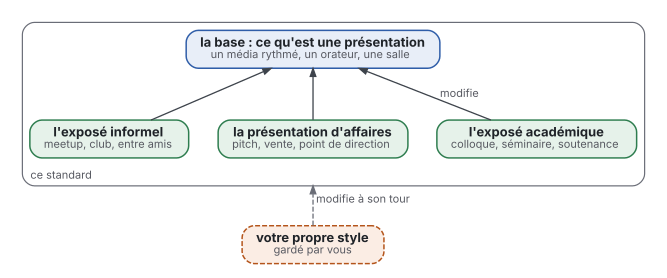
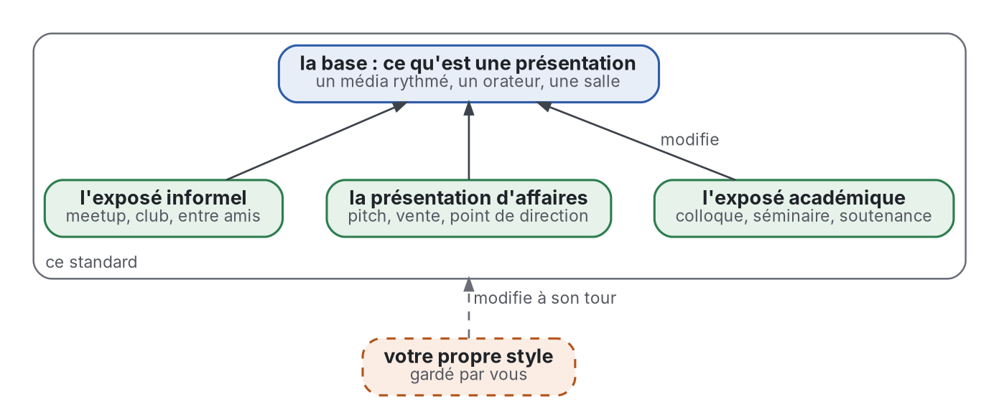

# Présentations

[](https://github.com/Tewf/reader-ergonomics-presentations/actions/workflows/checks.yml?query=branch%3Amaster)
[](https://tewf.github.io/reader-ergonomics-presentations/)

Comment construire une présentation que l'auditoire, ou le lecteur d'un diaporama, suit et retient au moindre coût ;
et, pour toute la famille de dépôts, comment dessiner une figure ou un diagramme.

Ce dépôt étend [reader-ergonomics](https://github.com/Tewf/reader-ergonomics). Les principes, leurs niveaux de preuve
et les vérifications y vivent et ne sont pas répétés ici. Ce dépôt n'ajoute que ce qui est propre aux présentations.

## Le prendre

Copiez le diaporama d'exemple, vérifiez-le avec la version du standard que ce dépôt épingle, puis faites-en votre exposé :

```sh
git clone https://github.com/Tewf/reader-ergonomics-presentations presentations
git clone https://github.com/Tewf/reader-ergonomics
git -C reader-ergonomics checkout $(grep -m1 -o '[0-9a-f]\{40\}' presentations/.github/workflows/checks.yml)   # la version que ce dépôt épingle
mkdir -p mon-expose/shapes mon-expose/checks
cp presentations/shapes/example-talk.* mon-expose/shapes/
cp -r presentations/checks/local presentations/checks/config.toml mon-expose/checks/
python3 reader-ergonomics/checks/run.py mon-expose
```

Corrigez chaque erreur, corrigez ou expliquez chaque avertissement, et répondez aux questions de
`mon-expose/checks/out/needs-judgment.md`. Le même plan, pour tout logiciel de présentation, est
[shapes/talk.md](shapes/talk.md). Pour faire vôtres ces formes, ou pour contester une règle, suivez la section [Take your own version](https://github.com/Tewf/reader-ergonomics/blob/v1.18.2/README.md#take-your-own-version) de reader-ergonomics : un style de lecteur, une extension ou une issue, selon l'objet du désaccord.

> **État :** en cours. Le [standard](standard.md) compte dix-sept principes en quatre groupes : neuf pour un exposé,
> avec trois contextes, la forme d'un exposé et un diaporama d'exemple ; huit pour une figure de tout document, avec la
> forme d'une figure. Huit vérifications s'exécutent ici, sept sur les diaporamas HTML et une question de jugement par
> figure. Les vérifications des diaporamas ont été essayées sur trois diaporamas de test, académique, d'affaires et
> informel, qui les ont changées ; ces diaporamas ne sont pas publics, et aucun principe n'a été testé sur un auditoire.
> C'est une lecture informelle de la recherche et de la pratique publiées : pas un standard officiel, pas une étude
> relue par des pairs, pas un résultat nouveau, et pas une prétention à l'état de l'art.
>
> **Comment il est fait :** avec Claude, un assistant IA d'Anthropic, sous la direction du mainteneur, comme
> reader-ergonomics. Des agents IA rédigent les revues de littérature ; chaque référence est résolue par programme, et
> un chiffre lu seulement dans un résumé est marqué « (secondary) ». Les corrections sont bienvenues en issues.

## Portée

Une base, et des contextes qui la modifient, comme un style de lecteur modifie le standard. La manière de présenter
de chacun est un style à part, gardé par lui, qui modifie à son tour ce standard. Depuis le 2026-10-29, ce dépôt est
aussi le standard de la famille pour les figures et les diagrammes de tout document ([décision 0006](decisions/0006-the-visual-standard-of-the-family.md)).



<details>
<summary>Source Graphviz</summary>



</details>

## Contenu

| Partie | Contient | État |
|---|---|---|
| [standard.md](standard.md) | la fiche : comment utiliser le standard, et chaque principe avec son niveau de preuve | écrit |
| [principles/](principles/) | dix-sept principes en quatre groupes : rythme, diapositive, exposé, figure | écrit ; essayé sur trois diaporamas de test, pas testé sur un auditoire |
| [reader-styles/](reader-styles/) | les contextes, écrits comme des auditoires : académique, affaires, informel | écrit |
| [shapes/](shapes/) | la forme d'un exposé avec un diaporama HTML d'exemple, et la forme d'une figure avec un exemple rédigé | écrit |
| [checks/](checks/) | huit vérifications, sept sur les diaporamas HTML et une question de jugement par figure, avec leurs tests ; les vérifications des figures par programme sont celles de reader-ergonomics | écrit |
| [decisions/](decisions/) | les choix qui ont façonné ce dépôt, un enregistrement chacun | sept enregistrements |
| [evidence/](evidence/) | deux revues multivocales : les présentations, en dix questions, et les figures, comment dessiner une figure ou un diagramme (question 11) ; 258 travaux | écrites, auditées |

## Ce qu'une présentation ajoute, et ce qu'elle n'ajoute pas

Ce qui est nouveau dans un exposé :

- l'auditeur ne règle pas le rythme et ne peut pas relire, ce qui fait entrer les principes de modalité, de redondance
  et de segmentation ;
- l'orateur fait partie du média ;
- la salle fixe la lisibilité, puisque les diapositives se lisent de loin.

Ce que reader-ergonomics contient déjà est lié, jamais recopié : la signalisation, la figure près de son texte, la
typographie.

## D'où il vient

Il a commencé le 2026-10-28 comme la moitié « exposés » de reader-ergonomics-academic, et l'a quitté le 2026-10-29 avec
son historique. Les deux moitiés s'étaient éloignées : à la séparation, leurs revues citaient 147 et 225 travaux, et en
partageaient 2.

## Le vérifier

```sh
git clone https://github.com/Tewf/reader-ergonomics
python3 reader-ergonomics/checks/run.py chemin/vers/ce/dépôt
```

La CI exécute les mêmes vérifications à chaque push, et une exécution échoue sur toute erreur
([checks.yml](https://github.com/Tewf/reader-ergonomics-presentations/blob/master/.github/workflows/checks.yml)). Le
badge en haut est le dernier résultat sur master. Chaque push sur master construit aussi le site,
[tewf.github.io/reader-ergonomics-presentations](https://tewf.github.io/reader-ergonomics-presentations/)
([pages.yml](https://github.com/Tewf/reader-ergonomics-presentations/blob/master/.github/workflows/pages.yml)).

## Licence

Code sous [Apache License 2.0](LICENSE) ; texte sous [CC BY 4.0](LICENSES/CC-BY-4.0.txt). Réutilisez-le comme vous le
souhaitez, en citant ce dépôt ; [CITATION.cff](CITATION.cff) donne une citation si besoin.

La version anglaise, [README.md](README.md), fait foi.
