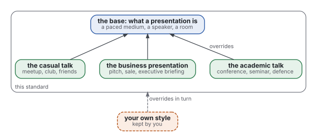
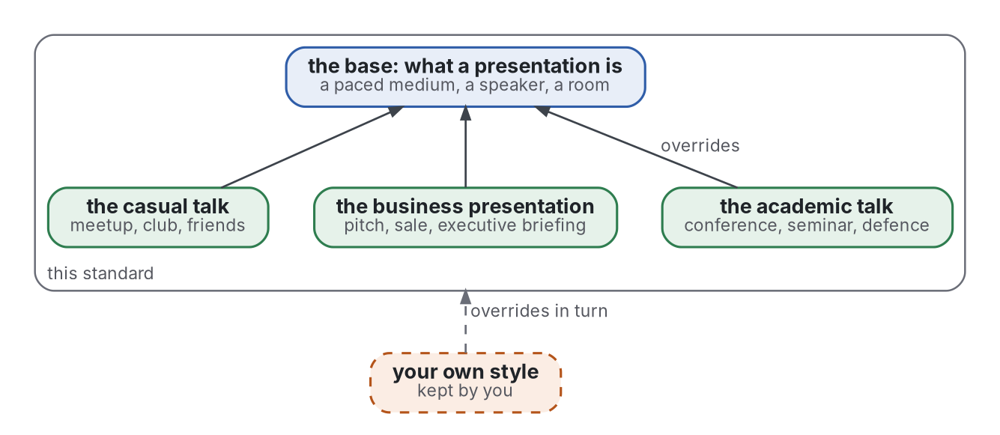

# Presentations

[](https://github.com/Tewf/reader-ergonomics-presentations/actions/workflows/checks.yml?query=branch%3Amaster)
[](https://tewf.github.io/reader-ergonomics-presentations/)

How to build a presentation that a listener, or the reader of a deck, follows and remembers at the least cost. For the
whole family of repositories, also how to draw a figure or a diagram.

It extends [reader-ergonomics](https://github.com/Tewf/reader-ergonomics). The principles, their grades and the checks
live there and are not repeated here. This repository adds only what is particular to presentations.

> **Status:** work in progress. The [standard](standard.md) has eighteen principles in four groups: nine for a talk, with
> three contexts, the talk shape and an example deck; nine for a figure in any document, with the figure shape. Eight
> checks run here, seven on HTML decks and one judgment per figure. The deck checks were tried on three test decks, an
> academic, a business and a casual one, which changed them; those decks are not public, and no principle has been
> tested on listeners. It is an informal reading of
> published research and practice: not an official standard, not a peer-reviewed study, not a new result, and not a
> claim to the state of the art.
>
> **How it is made:** with Claude, an AI assistant by Anthropic, under the maintainer's direction, the way
> reader-ergonomics was made. AI agents draft the literature reviews; every reference is resolved by script, and a
> number read only in a summary is marked "(secondary)". Corrections are welcome as issues.

## Scope

One base, and contexts that override it, the way a reader style overrides the standard. Anyone's own way of
presenting is a style of its own, kept by them, that overrides this standard in turn. Since 2026-10-29 it is also the
family's standard for figures and diagrams in any document ([decision 0006](decisions/0006-the-visual-standard-of-the-family.md)).



<details>
<summary>Graphviz source</summary>



</details>

## Contents

| Part | Holds | State |
|---|---|---|
| [standard.md](standard.md) | the card: how to use the standard, and every principle with its grade | written |
| [principles/](principles/) | eighteen principles in four groups: pace, slide, talk, figure | written; tried on three test decks, not tested on listeners |
| [reader-styles/](reader-styles/) | the contexts, as audiences: academic, business, casual | written |
| [shapes/](shapes/) | the talk shape with an example deck in HTML, and the figure shape with a worked example | written |
| [checks/](checks/) | eight checks, seven on HTML decks and one judgment per figure, with their tests; the program checks of figures are reader-ergonomics' own | written |
| [decisions/](decisions/) | the choices that shaped this repository, one record each | seven records |
| [evidence/](evidence/) | two multivocal reviews: presentations, in ten questions from the voice and the slide to motion, colour, business and casual talks; and figures, how a figure or a diagram is drawn (question 11); 258 works | written, audited |

## What a presentation adds, and what it does not

What is new in a talk:

- the listener cannot set the pace or reread, which brings in the modality, redundancy and segmenting principles;
- the speaker is part of the medium;
- the room sets legibility, since slides are read from a distance.

What reader-ergonomics already holds is linked, never copied: signalling, a figure next to its text, typography.

## Where it came from

It began on 2026-10-28 as the talk half of reader-ergonomics-academic, and moved here on 2026-10-29 with its history. The two
halves had grown apart: when they split, their reviews cited 147 and 225 works, and shared 2.

## Check it

```sh
git clone https://github.com/Tewf/reader-ergonomics
python3 reader-ergonomics/checks/run.py path/to/this/repository
```

CI runs the same checks on every push, and a run fails on any error
([checks.yml](https://github.com/Tewf/reader-ergonomics-presentations/blob/master/.github/workflows/checks.yml)). The badge at the top is
the last result on master. Every push to master also renders the site,
[tewf.github.io/reader-ergonomics-presentations](https://tewf.github.io/reader-ergonomics-presentations/)
([pages.yml](https://github.com/Tewf/reader-ergonomics-presentations/blob/master/.github/workflows/pages.yml)).

## Licence

Code under the [Apache License 2.0](LICENSE); prose under [CC BY 4.0](LICENSES/CC-BY-4.0.txt). Reuse it as you wish, with
credit to this repository; [CITATION.cff](CITATION.cff) gives a citation if you need one.
