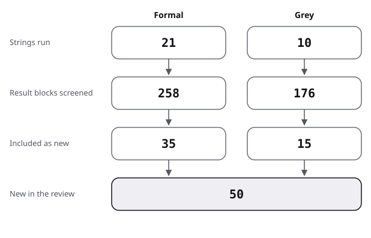

# Sources

This file lists each source of the figures topic, how it was found, and how much weight it can carry; the searches are in [protocol](protocol.md).

A grey score gives the eight subtotals of the [method](../README.md#method), in its order, then the total out of 20.

## Flow

| Stage | Formal | Grey |
|---|---|---|
| Strings run | 21 (E 4, F 17) | 10 |
| Result blocks screened | 258 | 176 |
| Included as new | 35 | 15 |
| Already held, linked not re-reviewed | see below | none |
| Of the 15 grey, at or above 10 of 20 | | 13 |

The figure draws the stages of the table.

- Rougier 2014 was found by a grey string (G46) but is peer-reviewed, so it sits among the formal rows; the formal string count of 21 counts E and F strings only.
- Excluded without opening: AI image-tool blogs, template marketplaces, sale pages for style books, tutorials with no named producer, mermaid-themed pages unrelated to diagrams (10 blocks of G48).
- Held and linked, not re-reviewed:
  - from the system-diagrams review: Moody 2009a, Purchase 2002, Ware 2002, Sharif 2010, Störrle 2011, Störrle 2016b, Nicacio 2022, Brown 2021;
  - diagram tools in practice: GitHub 2022, Mermaid 2026, Fuchsia 2025, GitLab 2026;
  - from the presentations topic: Sundararajan 2020, Cheng 2026, Rey 2012, Kosara 2013, Segel 2010, W3C 2023c, Wilke 2019, Kosslyn 2012.
- Seen, not retrieved: see the last section.

## Formal sources

Evidence grade is the grade of what the source shows. "Read" says how: full text, abstract, or secondary (a summary or a citing paper).

| Key | Kind | Found via | Quality | Used in |
|---|---|---|---|---|
| Burch 2021 | formal, survey (239 papers, 1995-2020), full text | E28 | supported with caveat; one-author tagging of each paper | review 1 |
| Thielsch 2019 | formal, meta-analysis, abstract | E29 | measured | review 3 |
| Schlamann 2026 | formal, preregistered meta-analysis, abstract (OpenAlex copy); Zenodo materials record returned 403 | E29 | measured | review 3 |
| Purchase 1997 | formal, controlled experiments, abstract (Monash record) | E27, F26 | measured | review 1 |
| Huang 2008 | formal, eye tracking, 16 subjects, abstract | F21 | supported with caveat | review 1 |
| Huang 2008b | formal, controlled, 22 participants per Burch 2021, abstract | F21 | supported with caveat | review 1 |
| Huang 2014 | formal, controlled, 37 participants, secondary (via Burch 2021) | F21 | supported with caveat | review 1 |
| Pohl 2009 | formal, eye tracking, 36 subjects, abstract and introduction read | E28 | supported with caveat | review 1 |
| Figl 2014 | formal, position paper, abstract | F22 | convention, untested | review 1 |
| Figl 2015 | formal, pilot experiment, 44 participants, abstract | F22 | supported with caveat | review 1 |
| Cleveland 1984 | formal, experiments, abstract (ranks via Heer 2010) | F15 | measured | review 2 |
| Heer 2010 | formal, crowdsourced replication, 82 workers in the replication and 186 across all experiments, full text | F15 | measured | review 2 |
| Talbot 2014 | formal, four experiments on bar charts, abstract | F15 | measured | review 2 |
| Palmer 1992 | formal, grouping demonstrations per the record read, abstract | F16 | measured (not verified) | review 2 |
| Palmer 1994 | formal, perception theory and experiments, secondary, abstract not reached | F16 | measured (not verified) | review 2 |
| Huestegge 2011 | formal, four eye-tracking experiments, abstract | F29 | supported with caveat | review 2 |
| Borkin 2016 | formal, 393 visualisations, 33 participants, abstract page | F18 | supported with caveat | review 2, 3 |
| Bateman 2010 | formal, experiment, 20 participants, full text | F17 | measured | review 3 |
| Borkin 2013 | formal, crowdsourced memorability, abstract | F27 | measured | review 3 |
| Harrison 2015 | formal, 1,278 participants, full text | E30 | measured | review 3 |
| Skau 2015 | formal, crowdsourced, abstract and Kosara's summary | F23 | measured | review 3 |
| Borgo 2012 | formal, dual-task experiment, abstract | F24 | measured | review 3 |
| Hullman 2011 | formal, argument with cited studies, abstract | F24 | convention, untested | review 3 |
| Tractinsky 2000 | formal, ATM experiment, abstract | F28 | supported with caveat | review 3 |
| Lindgaard 2006 | formal, 50 ms experiment, abstract | F28 | supported with caveat | review 3 |
| Elhamdadi 2023 | formal, trust framework and study, abstract | F25 | supported with caveat | review 3 |
| Song 2025 | formal, two crowdsourced experiments, preprint, partly read | F25 | supported with caveat | review 3 |
| Inbar 2007 | formal, preference study, 87 students, abstract | F20 | supported with caveat | review 3, 6 |
| Hill 2018 | formal, rating survey, secondary (a search summary of the abstract), page not opened | F20 | supported with caveat | review 6 |
| Zhong 2024 | formal, case study of two models on 500 random graphs, tables read | F19 | supported with caveat | review 4 |
| Das 2024 | formal, benchmark, abstract | F19 | supported with caveat | review 4 |
| Zou 2024 | formal, benchmark of vector graphics, full text | F19 | measured, one benchmark | review 4 |
| Ye 2025 | formal, benchmark, abstract | F31 | supported with caveat | review 4 |
| Singh 2024 | formal, benchmark (2,272 flowcharts), abstract | F31 | supported with caveat | review 4 |
| Rougier 2014 | formal, peer-reviewed expert guidance, full text | G46 | convention, untested | review 5 |

## Grey sources

| Key | Kind | Found via | Quality | Used in |
|---|---|---|---|---|
| W3C 2023g | grey, standard (tier 1), opened | G45 | 4/3/3.5/1/1/1/1/1 = **15.5** | review 4 |
| W3C 2023e | grey, standard (tier 1), opened | known address | 4/3/3.5/1/1/1/1/1 = **15.5** | review 4 |
| W3C 2023a | grey, standard glossary (tier 1), opened | known address | 4/3.5/3.5/1/1/1/1/1 = **16** | review 4 |
| W3C 2026a | grey, standards-body tutorial (tier 1), opened | known address | 4/3/3.5/0.5/1/0.5/1/1 = **14.5** | review 4 |
| Mermaid 2026c | grey, tool documentation (tier 2), opened | G48 | 3/2.5/3/0.5/0.5/1/1/0.5 = **12** | review 4 |
| GitHub 2026 diagrams | grey, platform documentation (tier 2), opened | known address | 3.5/2.5/3/0.5/0.5/0.5/1/0.5 = **12** | review 4 |
| Quarto 2026 | grey, tool documentation (tier 2), opened | G49 | 3/2.5/3/0.5/0.5/0.5/0.5/0.5 = **11** | review 4 |
| Urban 2025 | grey, institute style guide (tier 2), opened | G47 | 3.5/2/3.5/1/1/1/0.5/0.5 = **13** | review 5, baseline |
| FT 2026 | grey, newsroom chart-choice poster (tier 2), opened | G47 | 3.5/1.5/3/0/1/0.5/1/0.5 = **11** | review 5 |
| Europa 2023 | grey, public-sector guide (tier 1), opened | F17 | 3/2/3.5/0.5/1/0.5/0.5/0.5 = **11.5** | review 5, 6 |
| Datawrapper 2022 | grey, vendor help page (tier 2), opened | G53 | 2.5/1.5/2/0.5/0/0.5/1/0.5 = **8.5** (below 10) | review 5 (example only) |
| Few 2011 | grey, expert white paper (tier 2), read | G51 | 3/4/2.5/0.5/1/1/1/0.5 = **13.5** | review 6 |
| Kosara 2010 | grey, expert blog (tier 3), opened | F17 | 3/3/3/0.5/1/1/1/0 = **12.5** | review 6 |
| CUNY 2026 | grey, library accessibility toolkit (tier 2), opened | G44 | 2.5/1.5/3/1/0.5/0.5/0.5/0.5 = **10** | review 4 |
| Accessible Social 2026 | grey, advocacy site, undated (tier 3), opened | G44 | 1.5/1/2.5/0/0.5/0.5/0.5/0 = **6.5** (below 10) | review 4 (example only) |

Notes on the scores:
- Standards score high on authority and date and lose on methodology: they give rationale and examples, no experiment.
- Urban 2025 reports no study; it links to resources and states its rules as house style.
- Datawrapper 2022 explains its own product choices, so objectivity is low, and it cites no study.
- Europa 2023 was scored on the page read, which has no publication date; the copyright year is 2023.

## Seen, not retrieved or not opened

- A 2024 systematic review of graph layout evaluation, named in one summary; the summary gave no title or authors, so it could not be looked up.
- A 2012 review of aesthetics and usability by Lee and Koubek, named in a summary.
- Stevanetic and colleagues on hierarchical architecture views (more correct elements retrieved), and a thesis on Gestalt proximity in UML class diagrams, both named in F30 summaries; no year or link came with them.
- Wong's Points of View columns in Nature Methods ("Design of data figures", "Salience", "Layout"): seen in summaries of G52 only.
- BBC bbplot and R cookbook: the page opened truncated. The Guardian had no chart guide in the results. The New York Times: one summary says it has no written graphics style guide; not opened.
- Hill 2018: the site's certificate failed; the numbers come from a summary.
- Springer pages (Huestegge 2011) redirected to an authorisation step and were not followed.
- Giffgaff accessibility PDF on ASCII art; seen in the G44 list, not opened.
