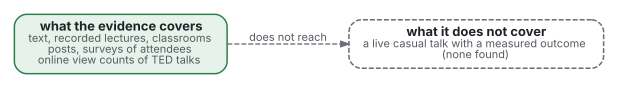
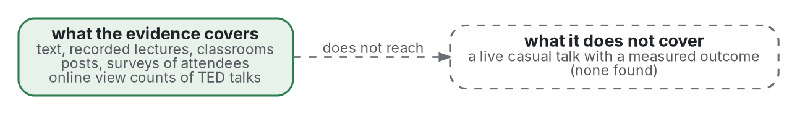

# Review

This file reviews the literature on presentations in strands: existing reviews first, then the experiments, then practice ([grey literature](../README.md#method)), each strand ending with what carries over to a live talk. Search strings and scores are in [protocol](protocol.md) and [sources](sources.md). Strands 7 (motion) and 8 (colour) were added in a second round.

## 0. Existing reviews

Found with strings E1 to E6 (protocol.md, Garousi 2019 Guideline 2).

- Noetel 2022 (overview of 29 reviews, 1,189 studies): 11 design principles raised learning, 5 eased cognitive load; design mattered more in system-paced settings such as lectures.
- Cromley 2025 (Mayer's own corpus, 181 studies): overall g = 0.37, shrinking slightly by year.
- Baker 2018 (PowerPoint in teaching) and Blome 2017 are the only reviews found that name slides or talks.
  - Blome 2017 (91 expert-opinion papers): 29 recommendations appear in over 20% of papers; experiments are scarce.
- Speaker: Hostetter 2011 and Dargue 2019 (gesture); Henderson 2021, Polat 2022 and Zhu 2024 (secondary) on a visible instructor, with no consistent learning gain.
- Not found by this search: a review of slide-design factors in a live talk, of talk structure, or of projected legibility.
- Seen in a summary, not retrieved, not included: a repository review of 31 PowerPoint studies; a 2025 review of teachers' gesture experiments.
- Motion (Q7), found with E7 to E13:
  - Animation against static pictures, self-paced: held in the [learning science review](https://github.com/Tewf/reader-ergonomics/blob/v1.13.0/evidence/learning-science/review.md) (animation section; overall d = 0.37 and g = 0.23, larger when the change is the thing to learn). Not repeated.
  - Noetel 2021 (105 randomised trials, 7,776 students): video replacing other teaching g = 0.28, video added to it g = 0.80 (abstract).
  - Tharumalingam 2025 (24 studies, 110 effect sizes): faster video playback lowers test scores, at a cost that is small and often not significant at 1.5 times or slower (abstract).
  - Kuang 2023 (18 studies, 203 effect sizes): an instructor's guided gaze g = 0.33 and direct gaze g = 0.30 on learning (abstract).
  - Brame 2016 (narrative review): manage load, raise engagement, promote active learning; Selvaraj 2021 reviews live coding (read as title and a summary only).
- Colour (Q8), found with H1 to H10 and E11:
  - Brom 2018 (33 samples, N = 2,924), Wong 2020 (28 articles), Mutlu-Bayraktar 2024 (51 articles) and Desiron 2026 (35 studies) review emotional design with pleasant colours.
  - Bramao 2011 (35 experiments, N = 1,535) reviews colour in object recognition.
  - Richter 2016 and Schneider 2018 are signaling meta-analyses. Whether either analyses colour coding as a moderator was not settled: only abstracts and an archive description were read. The abstract of Richter 2016 names colour coding as an example of a signal; the archive description of its data lists "distinctiveness of signals" as a moderator, not signal type.
- Not found by these strings: a review of slide builds or transitions, of live demos inside talks, of colour on projected slides, or of colour harmony and learning.
- How this review differs: its unit is the talk, not the lesson, and it adds genre, legibility and practice.

## 1. Paced media: modality, redundancy, segmenting

- Mayer 2020 summarises the principles. Mayer 2017 reports effect sizes from lab comparisons: redundancy d = 0.87, coherence 0.70, signalling 0.46, segmenting 0.70, modality 0.72 (secondary, abstract).
- Handbook chapters define each principle: Mayer 2014a (coherence, signalling, redundancy), Mayer 2014b (segmenting, modality), Kalyuga 2014 (redundancy).
- Most source lessons are short narrated computer lessons, a few minutes long, with system pacing (example: Mayer 2012, a 4-minute lesson with 11 slides).
- Redundancy, defined: the same words on screen and in speech. Kalyuga 1999 gave the first account in terms of split attention.
- Adesope 2012 (meta-analysis, 57 studies): spoken plus written equals written alone; it beats spoken alone only for low prior knowledge, system-paced and picture-free material.
  - The edge over spoken alone held for low prior knowledge, system-paced material and picture-free material.
  - Key terms taken from the narration did better than verbatim text.
- Yue 2013 (two experiments, college students, a narrated slide lesson): identical on-screen text and narration hurt recall and transfer.
  - A small discrepancy between text and voice did best; a large one did as badly as identical.
  - Learners preferred identical text and learned less from it.
- Modality: Ginns 2005 is the meta-analysis. Pacing moderates it (Table 2). Under system pacing d = 0.93 (k = 31). Under self pacing d = -0.14 (k = 7, 95% CI -0.32 to 0.04, which includes zero), so the effect disappears.
- Segmenting: Rey 2019 (56 studies, 88 comparisons) found small to medium gains in retention and transfer; learners with high prior knowledge gained more in retention (abstract).
- Signalling: Schneider 2018 and Richter 2016 (meta-analyses; see [learning science](https://github.com/Tewf/reader-ergonomics/blob/v1.13.0/evidence/learning-science/review.md)). Coherence: Sundararajan 2020.
- Carries over: a talk is system-paced, so these results are the nearest evidence, but no talk was studied in live rooms.

## 2. Slide design

- Baker 2018 (meta-analysis, 48 studies): no average difference between PowerPoint and traditional teaching, g = 0.067, CI -0.103 to 0.236 (abstract). K-12 gained, college did not.
- Levasseur 2006 (research review): student reactions, learning outcomes, learning styles and slide variation; the debate was mostly testimony.
- Kosslyn 2012 (three studies): eight psychological principles are often violated in slideshows, in every field; academic slides were no better than business slides. Observers noticed few of the violations by name.
- Garner 2013 is the central experiment (read in full).
  - n = 110 undergraduate engineers, random assignment, one 8-minute narrated talk (141 words a minute, same script).
  - Common-practice slides: topic phrase over bullets, 41.5 words per slide. Assertion-evidence slides: sentence headline of at most two lines, a graphic on each slide, 21.2 words per slide.
  - Essay with an analytic rubric: d = 0.81. Delayed sentence completion after about a week: d = 0.89. Perceived effort lower with AE, 3.01 against 3.61 on 7 points.
  - Immediate facts and statistics: no difference. The inference items favoured AE.
  - AE viewers judged their slides to carry less appropriate text than the others did.
  - The condition bundles six principles, so no single factor is isolated.
- Earlier Penn State work: Alley 2005 (sentence headlines and visual evidence), Alley 2006 (headline design and retention). Titles only; not read in full.
- Issa 2013 (field comparison, medical lecture, n = 37 and 43): a bullet lecture against slides redesigned on Mayer's principles. Delayed transfer d = 0.83 at 1 week, 1.17 at 4 weeks (abstract). Two cohorts; the abstract does not state random assignment.
- Forward citations of Garner 2013 found four studies:
  - Wolfe 2023: three pilot studies.
  - Wolfe 2025: on posters, complete assertion headings improved recall.
  - Alzayed 2023: 108 students who built slides; lower workload with AE, understanding unchanged.
  - Sripradith 2023: 59 students; AE better on a grammar test.
- Other tests of the design:
  - Alley 2007: two non-random comparisons of geology sections with earlier traditional ones. Scores rose (p < 0.001, then only p = .01), all bundled with active learning. Root Kustritz 2014: equal post-test, and only the traditional group fell at one month (self-selected groups, 31 traditional against 68 assertion-evidence).
  - Root Kustritz 2014: students chose their session, not randomised; equal post-test, and only the traditional group fell by one month.
- Audit of real decks: Le Blanc 2025 (one UK medical school) found text-heavy slides (over 10 words) on screen 84.4% of the time, a mean of 38.3 words per slide.
- Handouts and notes: Worthington 2015 (204 students, two semesters, not randomised) found provided slides had no effect on attendance and a worse exam result for students who took notes on them. Savoy 2009 (62 students) found 15% less retention of spoken content from PowerPoint talks, although students preferred PowerPoint.
- Laptop notes: Mueller 2014 found worse conceptual answers; Urry 2019 (N = 142) did not reproduce the quiz difference.
- Tufte 2003 and CAIB 2003 are argument and an accident report, not experiments (see against.md). Scores: Tufte 2003, 12.5 (not read); CAIB 2003, 18.5.

## 3. The speaker as part of the medium

- Mayer 2014c names the personalization, voice, image and embodiment principles; the experiments read here are Mayer 2012 and Kizilcec 2015.
- Gesture: Hostetter 2011 (63 samples) and Dargue 2019 (83 samples) both report a moderate benefit to comprehension when speech comes with gesture.
  - Hostetter: larger when the gesture is not fully redundant with speech, and larger for motor topics and for children.
- Mayer 2012: a human-voiced agent with human-like gesture, expression, gaze and movement gave better transfer than one without, in three experiments.
- Castro-Alonso 2021 (meta-analysis, 32 effects, N = 2104): small mean benefit of agents, g about 0.20. Most traits, including nonverbal communication and voice, did not moderate it; agent dimensionality did (2D agents 0.38 against 0.11).
- Instructor presence in video: Henderson 2021 (systematic review, 12 studies) found no consistent compelling evidence either way.
  - Fiorella 2019: drawing as you speak, d = 0.54, and eye contact with the camera, d = 0.54; mere visibility did not help.
  - Kizilcec 2015: in a field experiment (N = 12,468), strategic and constant face display gave equal learning.
  - Heidig 2024 (three field experiments in university courses, videos over 30 minutes): no effect on learning, none harmful; some affective gains.
- Enthusiasm: Marty-Dugas 2024 (two experiments, 22-minute lecture) found higher engagement with a vocally enthusiastic lecturer and no difference in quiz scores.
- Carries over: gesture and pointing are the best supported; a live speaker's face is not itself a measured benefit.

## 4. Legibility at a distance

- Contrast: WCAG 2.2 (W3C 2023b) sets 4.5:1 for text and 3:1 for large text, where large is 18 point or 14 point bold. Linked: [sufficient contrast](https://github.com/Tewf/reader-ergonomics/blob/v1.13.0/principles/page/sufficient-contrast.md) and Piepenbrock 2013.
- Section 508 (Access Board 2017): electronic content must meet WCAG 2.0 level A and AA (E205.4); non-web documents, which includes slide files, are exempt from four criteria.
- Microsoft 2026d (8.5, example only): every slide gets a unique title, text at 18 point or larger, reading order set, alt text on visuals (read on the page). Its checker flags missing titles, order and contrast on solid backgrounds only.
- Display sizing: AVIXA 2016 (ANSI/INFOCOMM V202.01) sizes an image from the farthest viewer. AVIXA's analytical calculator (now the 2026 edition) uses an acuity factor of 3438. The formula itself is in the paid standard (secondary, not checked).
- Size research is for reading, not projection: Legge 2011 (fluent range), Rello 2016 (18 and 26 point on screen). No study of projected size and comprehension in a room was found.
- Beamer 2026 itself says points mean little for projection; it counts lines per slide, 10 to 20.

## 5. Structure of a talk

- Carter-Thomas 2003 (methods paper): three ways to analyse a talk (syntax, move analysis, multimodal); the first two miss its multimodal character.
- Rowley-Jolivet 2005: 44 talks in geology, medicine and physics. Introductions are structured markedly differently from the paper's; the authors tie this to the contextual and epistemological features of the genre.
- Hood 2005 (introductions) and Dubois 1980 (slides in biomedical speeches): genre studies found by title, not read in full here.
- Rowley-Jolivet 2002 and Rowley-Jolivet 2012: slides and speech run in parallel with different wording; text slides are rephrased aloud (secondary).
- Q&A: Xu 2022 (80 computer science sessions, 268 turns, secondary) links question forms to functions and rapport work. Q&A research is sparse and mostly descriptive.
- Attention: Wilson 2007 and Bradbury 2016 reviewed the "10 to 15 minutes" claim; both found little primary support.

## 6. Practice (grey literature)

Scores out of 20 are in sources.md. A source under 10 is named here only as an example of practice, not as support.

- TED guidance (TED 2026, 9.5, example only): slides optional; one or two lines; legible from the farthest seat. Anderson 2016 (9.5, example only) is the book.
- Duarte 2008 (11.5) and Duarte 2010 (10.5), scored from catalogue pages; Reynolds 2008 (12) argues for restrained slides. The glance test (Duarte 2026, 5, example only) has about 3 seconds and no evidence on the page.
- Numeric rules, each a convention:
  - Kawasaki 2005 (6.5, example only): 10 slides, 20 minutes, 30 point (archived post read).
  - Peyton Jones 1993: 6 or 7 things per slide, 17 point, no outline slide, and a recap slide about a third of the way through (read in the paper).
  - Beamer 2026 (12): 20 to 40 words per frame, 80 at most (read in the guide, 5.1.3).
  - SSP 2026 (9, example only): title of 6 words, 6 lines of 7 words, type at least 1/40 of slide height (read in the guide).
- Pacing formats: PechaKucha 2026 (6) and Ignite 2026 (5.5) are examples only; the Lessig method is one word or picture per slide (secondary).
  - Liao 2020 (three classes): differences came mostly from choosing less material.
  - Warmuth 2021 (48 against 25 talks): higher immediate retention for presenters, no delayed difference.
  - Bakcek 2020 (randomised, n = 134): test scores equal, satisfaction higher.
- Bezos 2018 (10.5): no slides; narrative memos of about six pages read silently. Quality varies; no outcome data. Minto 1987 (9.5, example only) is the origin of consulting action titles; not read.
- Accessibility: Rector 2019 (14; nine guidelines, no evidence cited); ACM 2026 (9.5, example only) derives from it.
  - Both ask the speaker to say every slide word aloud; this runs against Adesope 2012, and no study of blind or low-vision listeners was found.
- Teaching centre: Bramble 2026 (11) recommends assertion-visual evidence, handouts for notes and 10-minute chunks (the rule against.md doubts); it names two studies by surname only.
- Built-in tools: Designer reached 1 billion slides by 2019, the owner's claim (Microsoft 2019, 6.5, example only; read on the blog).

## 7. Motion in a talk

What changes from a self-paced page: the viewer cannot stop, step or replay, so the speaker's pace stands in for the viewer's control.

- Who sets the pace:
  - Tabbers 2009: learner-paced instruction gave better transfer than system-paced, with a large rise in time on task (abstract).
  - Hatsidimitris 2012: a timeline scrollbar helped novices and did not help learners with more prior knowledge (abstract).
  - Carries over: a talk is system-paced, so the speaker's pauses and steps carry what the scrollbar carried. No study of that was found.
- Builds (progressive disclosure), all with recorded narration:
  - Liu 2022 (n = 99): key points appearing in step with the narration beat two other formats, on post-test and efficiency.
  - The two other formats: the whole slide at once, and narration followed by the picture (abstract; no effect sizes in it).
  - Ito 2026 (n = 40, one biology lesson): a cumulative slide gave higher learning, d = 0.49, and earlier looks at the matching element, d = 1.76 (abstract).
  - Miller 2011 (two semesters, astronomy): students judged animated slides more effective, exam scores were largely unaffected, and animating illustrations may do more than animating text (abstract).
  - Meij 2021: a whiteboard animation and a slideshow gave similar knowledge scores; the animation was rated higher, which the authors link to seductive details (abstract).
- Transitions: no study was found. WCAG 2.2.2 asks for a way to pause movement that starts by itself, lasts over 5 seconds and sits beside other content (W3C 2023d).
- Video inside a talk:
  - Ljubojevic 2014: an educational clip placed in the middle of a lecture was the most efficient; an entertainment clip was less so (abstract).
  - Zureick 2017 (survey, N = 439): students who always attended live or always watched video scored higher than those who mixed; interruptions went with lower scores (correlational).
  - Guo 2014 (6.9 million sessions, four edX courses in computer science, statistics, AI and chemistry): median watching time was at most 6 minutes whatever the video length.
  - Shorter videos, an interleaved talking head, Khan-style tablet drawing and a fast, enthusiastic speaker were each more engaging.
  - Engagement is watching time and problem attempts, not learning.
- Explainer video in the style of mathematical animation:
  - Voorde 2024 coded the visuals of a small sample of YouTube maths videos into seven role categories (four videos first, 25 to 50 visuals each). Radmehr 2024 analysed one 3Blue1Brown video, over 3.3 million views, as a case.
  - Bos 2025 (two sessions of about 20 calculus students, no control group): students learned from the videos and overestimated how much.
  - Naming a visual's learning goal went with better learning; a visual without a clear goal could hinder (abstract).
  - Pichler 2023 (thesis, 29, 42 and 30 viewers): an animation video and a slides-only video beat a slides-plus-professor video on the knowledge test.
  - Li 2023 (n = 290; secondary): animation and slideshow video abstracts gave the same comprehension; animation was more engaging, and higher engagement went with slightly lower comprehension.
  - Carries over: engagement and liking favour animation; learning is equal or mixed.
- Live demos and live coding:
  - Shah 2023 (two remote CS1 sections) found no learning difference between live coding and static code examples, and slightly lower grades for live coding.
  - Shah 2025 (about 530 students) found no learning difference between active and traditional live coding (not static code), with higher engagement after the in-class task (abstracts).
  - Lin 2022 (n = 33, no control group): watching experts' recorded live coding with annotations correlated with coding skill. Watching the experts' flowcharting gave r = 0.37 and their coding r = 0.41. Reflecting on syntax gave r = 0.51 (abstract).
  - No study of a live demo inside a conference talk was found.
- Practice (all conventions; sources under 10 are examples only):
  - Beamer 2026: animate the dynamics of a system, not to attract attention; use dissolves sparingly. Bramble 2026: use animation for in-between states. Rector 2019: avoid animation unless described aloud.
  - Nederbragt 2016 (11.5): say aloud what is typed, go slowly, mirror the learners' screen. LornaJane 2017 (8.5) and Mozilla 2026 (6): demo only what shows moving parts, rehearse, or play a silent screencast while speaking.
  - Microsoft 2026e (6) is a feature guide for Morph with no learning claim.
  - Sanderson 2026 (8) states an aim, not a result; Simpleshow 2021 (4.5) reports its own study of twice the gain over slides.
- Carries over: builds that follow the voice and show change have the best support; everything else about motion in a live room is untested.

## 8. Colour

- Colour coding as a signal:
  - Ozcelik 2009 (n = 52): colour-coding text and picture parts raised retention and transfer; eye tracking showed faster location of corresponding parts and attention drawn to salient items (abstract).
  - Clariana 2009 (N = 80): a left-margin background hue that signalled lesson sections helped a structure test, d = 0.41, and not a fact test, d = -0.17 (abstract).
  - Meusel 2024 (N = 191): a background colour as retrieval cue was not enough to help recall (abstract).
  - The signaling meta-analyses are in strand 1; whether they separate colour from other cues was not verified (strand 0).
- Emotional design with pleasant colours:
  - Um 2012 (N = 118): positive emotional design raised comprehension and transfer and lowered perceived difficulty (abstract).
  - Brom 2018, read in the author's manuscript: 33 samples, N = 2,924.
  - Retention d+ = 0.387 (k = 18), comprehension 0.317 (k = 14), transfer 0.327 (k = 27), intrinsic motivation 0.255; perceived difficulty -0.208.
  - Pleasant meant warm, bright, saturated colours.
  - Only 5 of the 33 samples (15.2%) changed colour alone; 11 changed faces only, 13 both, and 4 combined designs (Table 3). Of seven moderators, contrast type included, none held after correction for multiple comparisons, and the test covered only the outcomes that varied enough; age gave provisional evidence on intrinsic motivation. The authors say the mechanism is unclear and may be signalling.
  - Wong 2020: retention g+ = 0.35, transfer 0.27, comprehension 0.29. Mutlu-Bayraktar 2024 found contradictory learning results but agreement on motivation and emotion; Desiron 2026 found heterogeneous designs that limit comparison.
- Colour in data figures:
  - Harrower 2003 (ColorBrewer): schemes chosen by class number, data type (sequential, diverging, qualitative) and end use, projected included.
  - Borland 2007 and Crameri 2020 argue against the rainbow map. Crameri 2020 (read in full): jet-like maps can distort over 7% of the displayed data variation.
  - Its general estimate: 8% of men and 0.5% of women have a colour-vision deficiency.
  - Poor maps stay the default in software.
  - Liu 2018 (56 subjects, full text): viridis gave consistently low error; the diverging blue-orange scheme erred when a comparison crossed its centre (Figure 6, p. 6; p. 8). Reda 2021 (secondary): rainbow maps can help some inference tasks (see against.md).
  - Position and length before colour: [draw relations](https://github.com/Tewf/reader-ergonomics/blob/v1.13.0/principles/page/draw-relations.md).
- Colour-vision deficiency: WCAG asks that colour not be the only cue (W3C 2023c). Wong 2011 is the source of a widely copied eight-colour palette (secondary). Rector 2019, ACM 2026 and Microsoft 2026d give the same rule for slides; ACM 2026 names a simulator.
- Light against dark when projected:
  - Greco 2008 (three experiments, secondary): dark text on a light background was the most legible, on a laptop and projected under several room lights; pleasantness followed legibility.
  - Positive polarity in general: [sufficient contrast](https://github.com/Tewf/reader-ergonomics/blob/v1.13.0/principles/page/sufficient-contrast.md).
  - Practice disagrees: TED 2026 says bold text on a dark ground; Beamer 2026 warns that inverse video fails in bright rooms.
  - Schwabish 2014 (5, example only) reports the usual advice of a dark ground in a dark room, and finds no reason given for it.
- Colour harmony (art-school colour theory):
  - Schloss 2011: pairs of similar hue were rated more harmonious and preferred; strongly contrasting hue pairs were rated neither. Pair preference followed liking of each colour and lightness contrast.
  - Palmer 2010: liking for a colour follows the average liking of things that have that colour (abstract).
  - Both measure preference. No study of harmony and learning was found: harmony is preference only, on this search.
  - Ethos3 2026 (2.5, example only) teaches wheels (complementary, analogous). It states that colour decides up to 90% of quick purchase judgments, citing a study named Impact of Color in Marketing without a working link (the link goes to a journal list).
- Colour in natural images: Bramao 2011: colour aids object recognition, d = 0.28 overall. It is d = 0.43 for colour-diagnostic objects and d = 0.18, marginal (p = .06), for the rest; so keep photographs in their real colours.
- Practice on slides (conventions):
  - Beamer 2026 (12): few colours, maximum contrast, darken bright colours on white, no decorative background shading.
  - Bramble 2026 (11): three colours, consistent by kind. SSP 2026 (9, example only): high contrast.
  - Duarte 2026 and Leonhard Center 2026: their pages say nothing on colour.
  - Palettes: ScotGov 2024 (12.5) gives one colour per category in a fixed order, 3:1 against white, at most 4 colours per chart (guide not checked; source designsystem.gov.scot/guidance/charts/data-visualisation-colour-palettes).
  - EU 2023 (14): a rainbow map made a front that is not in the data.
  - Wilke 2019 (14.5): avoid encoding too much in colour, and design for colour-vision deficiency. Matplotlib 2026 (14.5): choose maps by lightness.
- Carries over: colour as a signal and as a safe palette has support; pleasant colours help a little in lessons; harmony and hue meaning for a live audience are untested.

## 9. Business presentations (added 2026-10-29)

The sources of this strand were found with strings E14 to E18, F3 to F8 and G32 to G37 (protocol.md); those under 10 of 20 are examples of practice only.

### 9.0 Existing reviews

- Kalvapalle 2024 reviews 252 papers on entrepreneurial pitching since 1986 (abstract).
  - The field splits into work centred on the entrepreneur and work centred on the investor.
  - The communicative process between them is called undertheorised by the authors.
- Ferrati 2021 reviews the criteria equity investors use: 894 papers screened, 53 analysed, 208 criteria grouped into 35 categories, 11 classes and 4 domains.
- Kernbach 2015 reviews the literature on PowerPoint in business and education; the findings are in 9.6.
- Not found: a review of business presentations as a form (slides, memo, briefing), of executive or board briefings, or of the sales presentation.
- Held and not repeated: Kosslyn 2012, Garner 2013, Ginns 2005, Adesope 2012, Baker 2018, Rowley-Jolivet 2005.

### 9.1 Structure (Q9a)

| Source | Claim | Grade |
|---|---|---|
| Minto 2026 (6.5, example only) | the pyramid: one point at the top, ideas grouped under it; the SCQ frame (situation, complication, question) names the question in the reader's mind; the page cites no study | convention, untested |
| Millerd 2025 (3.5, example only) | consulting decks use sentence titles that state the takeaway, a top-down storyline, and a ghost deck (titles first) to test the argument before the data | convention, untested |
| Britt 2003 (full text) | in Experiments 1, 2 and 3b (undergraduates), two-clause arguments with the claim first were read about 0.7 to 1.1 s faster than with the reason first, but only when the claim was clearly marked (for example by "should"); claims were recalled better than reasons in either order, and reason-first arguments tended to be recalled in claim-first order | supported with caveat: single sentences, not talks |
| Garner 2013 (held) | sentence headline plus a graphic beat topic phrase over bullets, d = 0.81 on an essay and 0.89 delayed; students, not buyers or investors | supported with caveat, linked |
| Kosslyn 2012 (held; abstract read) | 140 web-posted slideshows: violations were common in every field; business slideshows (32) were not significantly different overall; their raw violation rate is higher than research on compatibility (0.53 against 0.15, strict scoring), perceptual organisation and over-determined rules, none of them tested | measured, descriptive |
| Clark 2008 | angels commented on clarity, structure and information amount in three pitches (24 raters) | supported with caveat: small sample |
| Rowley-Jolivet 2005 (held) | academic talks open differently from papers (44 talks) | measured, descriptive, linked |
| (gap) | no experiment compares answer-first with background-first for a business talk or deck; BLUF's origin in an Army regulation could not be read | not tested |

- The base build-up (background, method, result) is the academic genre's habit; the evidence for answer first is a short-text effect plus convention.
- The regulation behind BLUF (AR 25-50) was not retrieved; its text is not quoted anywhere here.

### 9.2 Decision audiences (Q9b)

| Source | Claim | Grade |
|---|---|---|
| Clark 2008 | 24 UK angels rated three oral pitches on 32 aspects: higher overall presentation scores went with more interest; delivery style weighed most; angels gave market, product and funding as reasons and seemed unaware of the effect | supported with caveat |
| Chen 2009 | in a lab experiment and a field study, VCs' funding decisions followed perceived preparedness, not perceived passion (abstract) | supported with caveat: sample sizes unread |
| Cardon 2017 | 72 angels made 1,995 evaluations of 133 live pitches (1,966 decisions in the multilevel model): preparedness raised evaluations of funding potential, more so when the entrepreneur had put in more of their own money; enthusiasm had no main effect (full text); enthusiasm, preparedness and commitment behave as distinct cues (abstract) | supported with caveat |
| Yang 2021b | 79 VC and project pairs in a Chinese VC setting: enthusiasm and preparedness both raised willingness to invest (abstract) | supported with caveat |
| Pollack 2012 | 113 funded pitches from 14 Shark Tank and 84 Dragons' Den episodes: preparedness raised perceived legitimacy, which raised the amount funded | supported with caveat: televised, funded pitches only |
| Brooks 2014 | across three pitch competitions and two experiments, the same pitch content was more persuasive from a male presenter; attractiveness helped men, not women (abstract) | measured |
| Brooks 2014 | 90 videoed pitches; voice-swap experiment favoured male-voiced plans (68%) (full text, author copy) | measured |
| Kanze 2018 | in a field study of live Q&A, investors asked men promotion-focused and women prevention-focused questions; each added prevention-focused question went with less money raised; in an experiment, promotion-focused answers raised funding (regulatory focus) | measured |
| Bernstein 2017 (full text) | an email experiment with 16,981 emails to 4,494 investors: on average investors responded to information on the founding team, not to traction or lead investors; the more experienced responded only to the team, while inexperienced investors (no prior investments, 18%) also responded to traction and to current investors | measured (screening stage only) |
| Huang 2015 | angels used intuition more than analysis, and their emphasis on judging the entrepreneur predicted very profitable ventures four years later (abstract) | supported with caveat: not a study of pitches |
| Clingingsmith 2018 | pitch training was assigned at random at four elevator-pitch competitions; the abstract says the data support the four hypotheses of an investor real-option model; coefficients unread | measured, details unread |
| Sequoia 2019 (8.5, example only) | ten sections: purpose, problem, solution, why now, market, competition, business model, team, financials, vision; the only evidence is an anecdote | convention, untested |
| Huthwaite 2026 (8.5, example only) | the SPIN sales method rests on question types (situation, problem, implication, need-payoff); the originator states a large call study, and the page offers no result on presenting | convention; the study is the originator's account |
| (gap) | no study of executive or board briefings, or of what a buyer decides on in a presentation, was found | not tested |

- Investors weigh the person and the preparation, and say they weigh the content. The same evidence (Clark 2008, Brooks 2014) says the presenter cannot be separated from the pitch.
- Passion is the contested cue: Chen 2009 against Yang 2021b, with Cardon 2017 saying the cues are separable.

### 9.3 Formats (Q9c)

| Source | Claim | Grade |
|---|---|---|
| Bezos 2018 (held, 10.5) | no slides at Amazon; six-page narrative memos read silently at the start of a meeting; quality varies; no outcome data | convention, untested |
| Tufte 2022 (5, example only) | two former Amazon leaders say the memo format is highly effective; the page is a seminar seller's promotion and gives no data | convention, untested |
| (gap) | no experiment compares a memo with a deck for comprehension or decision quality (F8 returned opinion only) | not tested |
| DocSend 2022 (12) | 320 decks (sample for slide content only; the sample for viewing times is not stated): a deck got just under three minutes; unsuccessful decks were abandoned after 2 minutes 13 seconds; the team slide appeared in 100% of decks; about a quarter had financials, none of the unsuccessful ones; product and business model drew the most attention | descriptive, owner's data, sample not stated |
| DocSend 2026 (7, example only) | an average of 2 minutes 42 seconds per deck; investors spent 88% more time on the competition section; sample not stated | convention (example of practice; owner figure, sample not stated) |
| Yates 2007 (secondary) | a chapter on the PowerPoint presentation and its corollary genres (not verified: only a bibliographic record was reached, so whether a printed deck loses the talk is unread) | supported with caveat |
| Ginns 2005 (held) | the modality effect depends on pacing (full text, Table 2: d = 0.93, 95% CI 0.82 to 1.05, 31 effects, under system pacing; d = -0.14, 95% CI -0.32 to 0.04, 7 effects, under self pacing) | measured, linked |
| Adesope 2012 (held) | spoken plus written text equals written alone; the advantage over spoken-only text holds for low prior knowledge, system-paced and picture-free material; a reader without a speaker has no voice to repeat | measured, linked |

- A deck read alone is self-paced. The held evidence on repeating the voice was gathered under system pacing, so it does not bind a deck read at the reader's own speed. This is an inference from held sources, untested on decks.
- A deck read in under three minutes (DocSend 2022) is a scan, so what the headline of each slide says is most of what is read. Untested; the headline result (Garner 2013) is for a spoken talk.

### 9.4 Persuasion and attention (Q9d)

| Source | Claim | Grade |
|---|---|---|
| Zebregs 2015 | in a meta-analysis (health campaigns), statistical evidence had the stronger effect on beliefs and attitude, narrative evidence on intention | measured, in health |
| Chen 2009 | read as a persuasion analysis: perceived preparedness, not passion, persuaded VCs | supported with caveat |
| Brooks 2014 | delivery features unrelated to content (voice gender, looks) moved persuasion | measured |
| Kanze 2018 | the regulatory focus of a reply (promotion-focused or prevention-focused) to an investor's question changed funding | measured |
| Segel 2010 | seven genres of narrative visualisation, one of them the slide show; the taxonomy came from 58 items (author PDF read); (secondary) a later paper calls it prescriptive when it was meant as generative | convention (taxonomy) |
| Kosara 2013 (secondary) | argues that data presentation with storytelling elements deserves research of its own, because stories aid memory | convention, untested here |
| (gap) | no study tested storytelling or data storytelling in a pitch, sales call or briefing; the narrative against statistics evidence is from health | not tested |

- What is supported: preparedness persuades; statistics move beliefs, stories move intention (health setting).
- What is not supported in business: a claim that storytelling closes deals, or that passion does.

### 9.5 Practice (Q9e)

Score table: [sources](sources.md). Held: Duarte 2008 (11.5), Reynolds 2008 (12), Kawasaki 2005 (6.5, 10 slides, 20 minutes, 30 point), Minto 1987 (9.5).

| Source | Practice | Grade |
|---|---|---|
| Millerd 2025 (3.5) | action titles, storyline read from titles alone, ghost deck | convention |
| Minto 2026 (6.5) | pyramid and SCQ; used by "all of the major consulting firms" (the page's claim) | convention |
| Sequoia 2019 (8.5) | ten-section pitch outline; values clear thinking over polish | convention |
| DocSend 2022 (12) | team slide in every deck; short reading time | descriptive, owner's data, sample not stated |
| Huthwaite 2026 (8.5) | SPIN question sequence; originator's account of 35,000 calls | convention |
| Bezos 2018 (10.5) | memo instead of slides | convention |

- Only one of the seven new grey sources reaches 10 of 20, and it is a count. The rest are examples of practice.
- No firm's own document (McKinsey, Bain, BCG) was found; the consulting conventions come from a trainer and an author site.
- Accelerator guides: Sequoia read; Y Combinator's page returned no body. Design-firm guides: held (Duarte, Ethos3).

### 9.6 Against (Q9f)

Detail in [against](against.md). In one line each:

- Kernbach 2015 finds 18 constraining qualities of PowerPoint in business and education: cognitive, emotional and social.
- Kosslyn 2012 finds flaws in business slides as in academic ones, and observers rarely name them.
- Practice says "passion"; Chen 2009 found preparedness, and the matter is open (Yang 2021b).
- Practice says content decides; Clark 2008 and Brooks 2014 say delivery and presenter weigh in unnoticed.
- Practice says memos beat slides; no study compares them.

### What carries over to the base

- Sentence headlines, one claim per slide, a figure as evidence (Garner 2013): nothing in Q9 contradicts them.
- Business adds the decision, the person, the ask, the reader without a speaker; the candidates are in [position](position.md) (the business context).

## 10. Casual talks (added 2026-10-29)

Search strings and scores are in [protocol](protocol.md) and [sources](sources.md). Grades: measured, supported with caveat, convention (untested), not supported. "(secondary)" marks a number read only in a summary.

A casual talk is informal and voluntary:

- a meetup or club talk, or a lightning talk;
- a talk to friends or classmates;
- a popular-science talk, or a project explained to non-specialists.

Graphviz source

### 10.0 Existing reviews

- No review, systematic or scoping, of casual talks, of lightning talks or of PechaKucha was found (E19, E22, E23, C1 to C3, C7).
- The nearest are three reviews of parts of the problem: audience in science communication (McCarthy 2025), narrative (Dahlstrom 2014), humour in teaching (Zhou 2025).

### 10.1 Audience (Q10a)

| Source | Claim | Grade |
|---|---|---|
| McCarthy 2025 | Across 1,360 articles from five science-communication journals, only 4% defined their audience and 48% used a general, non-specified or "public" conception; the authors call this framing simplistic and tie it to the unfinished move away from deficit-model thinking | measured, descriptive |
| McCarthy 2025 | Among the 23 of 45 responding educators who defined audience, 22% used a general framing against 48% in the literature; the sample is self-selected, so this is a hint, not proof that teaching is ahead | measured, descriptive |
| Childers 2021 | Science-cafe attendees (survey n = 124, interviews n = 17) came for knowledge and learning, and for talking with other attendees and experts | supported with caveat |
| Childers 2021 (read in full) | Attendees chose to come, and their stated motives were learning and company. The authors say their respondents self-selected (84% held a four-year degree) and cite earlier work for cafes reaching mostly people already interested in science; that a "general" audience is rarely general follows, and remains an inference | supported with caveat |
| Rakedzon 2017 | In 5,000 abstract and lay-summary pairs from two PLOS journals, lay summaries held less jargon than abstracts but still more than the 2% the authors cite as recommended; the 98% threshold is from reading research, and the tool was validated on lecture transcripts too | supported with caveat |
| Kalyuga 2014 (held; a handbook chapter on the redundancy principle, not on expertise reversal) | Support that helps novices can hurt experts (expertise reversal, which has its own chapter in the same handbook, not read here); a mixed room has both | supported with caveat (chapter) |
| Noetel 2022 (held) | Design principles mattered more when the medium sets the pace; a talk is such a medium | measured |
| Bradbury 2016, Wilson 2007 (held) | The claim that attention collapses after ten minutes has little primary support | supported with caveat |
| Sugimoto 2013 | Online views of TED talks: academics drew more comments than other presenters; their view counts were not clearly higher; viewers may have been largely academics (a stated limit) | supported with caveat (observational) |

- Nothing found compares voluntary with obliged attendance for the same talk.
- No study tests the rule that a talk should state who it is for and what the audience knows; McCarthy 2025 only shows that 96% of papers never define their audience.

### 10.2 Form: lightning talks and short fixed formats (Q10b)

| Source | Claim | Grade |
|---|---|---|
| Bakcek 2020, Liao 2020, Warmuth 2021 (held) | The few studies of PechaKucha in class: one randomised trial found equal test scores (Bakcek 2020); a second found higher immediate retention for presenters but no delayed difference (Warmuth 2021); Liao 2020 found differences mostly from intentional selection of material | supported with caveat |
| PechaKucha 2026, Ignite 2026 (held) | Ignite's home page states a mission of inspired connection, personal growth and communication skills; examples only (not verified: the PechaKucha about page returned only a JavaScript stub) | convention, untested |
| ERIC C1 to C3 | 21 PechaKucha items, 5 lightning-talk items and 1 Ignite item: teaching reports and student surveys; none measures what an audience keeps | convention, untested |
| Hilton 2022, WooCommerce 2026 (examples) | Organisers use short talks to lower the barrier for first-time speakers; this is a claim about speakers, not listeners | convention, untested |
| Three Minute Thesis rules (UQ 2026) | Fixed time, one static slide, a jury scoring understanding and engagement; the programme pages report no outcome data | convention, untested |
| Guo 2014 (held) | The six-minute video chunk comes from watching time, not learning | supported with caveat (observational) |

- No study compares a lightning talk with a longer talk on the same content for a lay audience (G43).
- What a short slot forces is cutting. Whether the cut helps the listener is unmeasured.

### 10.3 Engagement: humour, narrative, personal tone, questions (Q10c)

| Source | Claim | Grade |
|---|---|---|
| Zhou 2025 | In about 140 works, humour related to the content is linked to perceived learning, attention and rapport; actual learning gains are mixed; unrelated and aggressive humour is more variable or harmful; evidence is mostly self-report | supported with caveat |
| Kaplan 1977, Suzuki 2014 (secondary); Garner 2006 | Kaplan 1977: concept-related humour helped retention at six weeks, only on the items tied to the humorous examples (Banas 2011 confirms both; that immediate comprehension did not change is not verified). Suzuki 2014 (165 participants): recognition, not recall, differed by condition (not verified: which condition, the abstract is cut off). Garner 2006, read in full: one randomised experiment on three recorded statistics lectures (94 analysed of 117); humour tied to the lecture, inserted three times, raised recall from 77.3 to 88.4 out of 100 at one test after the last lecture (F(1, 92) = 73.81, p < .001); no delayed test, no effect size printed | supported with caveat |
| Banas 2011 (read in full) | A four-decade narrative review, with no effect sizes: the evidence that humour raises learning is mixed, and the clearest effects are on classroom climate. Related, nonaggressive humour is the appropriate kind; aggressive humour harms climate and motivation | supported with caveat |
| Cheng 2026b, Sundararajan 2020 (held); Rey 2012 | Interesting but irrelevant material lowers learning. Cheng 2026b: g = -0.16 over 50 studies and 177 effect sizes (comprehension -0.19, recall -0.17, transfer -0.12). Sundararajan 2020, read in full: g = -0.33 (95% CI -0.48 to -0.18) over 68 effects from 58 papers and 7,521 participants, mostly on immediate tests. Rey 2012, read in full: retention d = 0.30 (34 experiments) and transfer d = 0.48 (21), a positive d meaning lower scores; journal articles only | measured: three meta-analyses, Cheng 2026b read at abstract level |
| Frank 2025 | In a survey experiment (2,212 analysed), mild humour raised mirth, and mirth predicted a scientist's likability (B = 0.48) and perceived legitimacy (B = 0.46); trust and credibility were not measured; mediation is correlational; one topic, one fictional scientist | supported with caveat |
| Freiling 2024 (read in full) | In a US quota sample (N = 796) that heard a 1.5-minute podcast clip, gentle satire did not change how credible the information seemed (B = -.21, p = .09) and harsh satire lowered it (B = -.44, p < .001); harsh satire lowered intent to rely on the information only through that credibility. Trust in the scientist was not measured; one clip and one topic per condition | supported with caveat |
| Dahlstrom 2014 | Narratives are associated with increased recall, ease of comprehension and shorter reading times, and raise interest and engagement; they are intrinsically persuasive, with ethical considerations (full text, read 2026-10-29). The "twice as fast, twice as well" figure compares narrative with expository text in earlier studies it cites (secondary), and a meta-analysis of health narratives it cites found mixed results (secondary) | supported with caveat |
| Zebregs 2015 (held) | In health campaigns, statistical evidence moved beliefs and attitude more, narrative evidence moved intention | measured, in health |
| Ginns 2013, Mayer 2014c (held) | A conversational, first-person style: d = 0.46 on friendliness and 0.62 on effective processing (reliable); 0.16 on learning assistance and 0.15 on interest (not reliable); retention d = 0.30, transfer d = 0.54; small, non-significant effects in lessons of 35 minutes or more. Read in full: 74 effects from 22 reports and 3,312 students; the lessons were on computer (narrated animations, tutors, simulations) or on paper, mostly college science, and none was a live talk | measured for Ginns 2013 (meta-analysis, read in full); supported with caveat (chapter) for Mayer 2014c |
| Hunsu 2016 (read in full) | Audience-response systems in classes, mostly college (53 articles): small gains overall (cognitive g = 0.05 over 86 effects; non-cognitive g = 0.23 over 25). When the comparison class already asked similar questions, the cognitive gain is g = 0.00, against 0.13 when it did not: the questions, not the device, carry it. No test in a live talk | supported with caveat |
| Segal 2026 | In 1,239 TED transcripts, clarity of explanation, scored by a language model (50 runs per transcript), predicted likes (beta = .339) and views (beta = .314) beyond duration, topic and scientific status; the model explained 22.5% of the variance in views; an observational preprint | supported with caveat |
| Sugimoto 2013 | No significant rise in citations was found after a TED talk (uncontrolled before-after); the one exception, 2007, rested on 18 academics already rising | supported with caveat (observational) |

- Views are a popularity count. They are not comprehension and not memory.
- No experiment varies storytelling, humour or personal tone in a live talk to a voluntary lay audience.

### 10.4 Slides or none (Q10d)

| Source | Claim | Grade |
|---|---|---|
| Savoy 2009, Baker 2018 (held) | Slides were neutral on average (Baker 2018: g = 0.067, CI -0.103 to 0.236; K-12 gained, college did not); whether design decides is untested here (not verified: the Savoy 2009 abstract was never reached) | measured for Baker 2018 |
| TED 2026 (held), PyCon 2026 (example) | Practice lets the speaker drop or cut slides: one or two lines, large type | convention, untested |
| Three Minute Thesis rules (UQ 2026) | One slide, no props | convention, untested |
| Shah 2023, Shah 2025 (held) | Live coding taught no more than static code (Shah 2023). Active live coding taught no more than traditional live coding but held engagement higher (Shah 2025) | measured |
| Nederbragt 2016, LornaJane 2017 (held) vs PyCon 2026 | Practice differs: PyCon says never; LornaJane is wary and keeps demos for long slots; Nederbragt teaches by live coding in workshops | convention, untested |

- No study of a talk given with no slides at all was found (F17).

### 10.5 Practice (Q10e)

All four sources score under 10 of 20 and are examples only.

| Source | Claim | Grade |
|---|---|---|
| ACM Local 2026 (7.5) | A meetup talk need not be an academic paper presentation; topics and speakers need only be interesting; attendance rises 40% with food and drink (no data) | convention, untested |
| WooCommerce 2026 (7) | Encourage audience members to try lightning talks; confirm a week before; check AV on the day; good content matters more than polished delivery | convention, untested |
| Hilton 2022 (4.5) | Cap talks at 30 minutes; 10 to 15 minutes for first-timers; run Q&A as discussion and stop hostile questions; meetups suit entertaining and story-based talks | convention, untested |
| PyCon 2026 (6.5) | Know the topic; skip the basics; build like a story; avoid forward references; limit code to about 10 lines per slide; rehearse aloud at least twice; run short rather than long | convention, untested |

- Between two or three of the four: a short time box (Hilton, PyCon), a first-time speaker welcomed (Hilton, WooCommerce). Rehearsal aloud is in PyCon only; ACM has no time box and no rehearsal advice; WooCommerce has no rehearsal advice; Hilton and ACM do not state one idea.
- None cites a study. Two (ACM, WooCommerce) are about organising, not about the talk.

### 10.6 Against (Q10f)

Detail in [against](against.md). In one line each:

- "Use humour" meets mixed learning results and the seductive-details effect.
- "Tell a story" meets Dahlstrom's ethical caution and, in health campaigns, Zebregs 2015 (the mixed health meta-analysis attributed to Dahlstrom is not verified).
- "Avoid live demos" and "do live demos" are both advised; the controlled studies, in programming classes, show no learning gain either way.
- Views of TED talks are read as success; they track clarity (scored by a language model), and no significant citation rise was found.
- Short talks are praised; no study shows that listeners keep more.

### What carries over to the base

- Define the audience and what it knows (McCarthy 2025; Kalyuga 2014 is a chapter on redundancy, not on expertise reversal): in the base already.
- Related, not decorative, material only (Sundararajan 2020): in the base.
- The candidate casual overrides are in [position](position.md) (the casual context).
