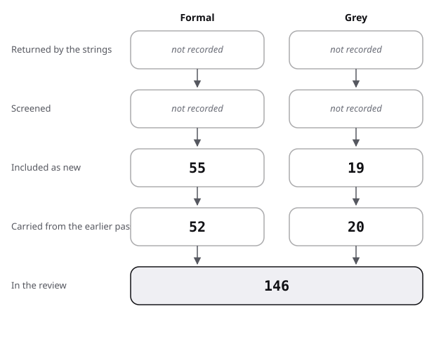

# Sources

This file lists the pool of sources behind the review, with how each was found and how good it is; the search itself is in [protocol](protocol.md).

## Flow

| Stage | Formal | Grey |
|---|---|---|
| Returned by the strings | not recorded | not recorded |
| Screened | not recorded | not recorded |
| Included as new | 55 | 19 |
| Carried from the earlier pass | 52 | 20 |
| In the review | 107 | 39 |

- Formal:
  - 52 sources were in the pool before the first round of the review, built by narrative search and snowballing.
  - The strings E, F and G of the first round found 12, and the second round (Q7 and Q8) found 43, which gives 55 as new.
  - Returned and screened counts are given per string in the protocol, with no total by kind.
- Grey:
  - 20 sources were in the pool before the first round.
  - The first round found 4 and the second round 15, which gives 19 as new.
  - Of the 39 grey sources, 20 score at or above 10 of 20 and 19 score below it (examples of practice only).

In the review: the presentations source rows of each kind, counted by script.

The figure draws the stages of the table for presentations.

- Strings: first round 6 existing-review (E), 2 follow-up (F), 12 grey (G); Q7 and Q8 round 7 existing-review (E7 to E13), 23 formal database strings (H, M, V), 19 grey (G13 to G31). That is 69 strings and 628 results screened in all (225 and 403).
- Excluded without opening: blogs and template vendors (tier 3), event listings, repeats, papers on web pages, packaging and marketing colour. Seen, not read: two IEEE guides (certificate error), a Tufte page on projection backgrounds (HTTP 403), a science-communication colour PDF.
- Not included though seen in a summary: a repository review of 31 PowerPoint studies; a 2025 review of teachers' gesture experiments.
- Also not included: a 2020 meta-analysis of signaling in training (abstract fragment only), and a study of sequential display and retention seen as an abstract in a Geneva archive.

## Subtotals of grey sources

Scores for the Q7 and Q8 round were read from the page or the PDF on 2026-10-28. The wide-use credit in the impact column rests on what the page says about itself unless a count is named. The quality field gives the eight subtotals in the order A to T defined in the [method](../README.md#method), then the total of 20. Books marked "catalogue page only" or "not read" are scored on what the page or earlier notes show.

## Grey sources

| Key | Kind | Found via | Quality | Used in |
|---|---|---|---|---|
| TED 2026 | grey, owner guide (tier 2) | prior pool; G1 | 3/4/0/0.5/0/1/0.5/0.5 = **9.5** (below 10) | review 6, baseline, 8 |
| Duarte 2008 | grey, book (tier 1), catalogue page only | prior pool | 4/3/0.5/1/0.5/1/0.5/1 = **11.5** | review 6 |
| Duarte 2010 | grey, book (tier 1), catalogue page only | prior pool | 4/2.5/0.5/1/0.5/0.5/0.5/1 = **10.5** | review 6 |
| Duarte 2026 | grey, owner guide (tier 2) | prior pool | 2/2/0/0/0/0.5/0/0.5 = **5** (below 10) | review 6, position |
| Reynolds 2008 | grey, book (tier 1), catalogue page only | prior pool; G12 | 3.5/3.5/1/1/0.5/1/0.5/1 = **12** | review 6 |
| Anderson 2016 | grey, book (tier 1), catalogue page only | prior pool | 3.5/2.5/0.5/1/0/0.5/0.5/1 = **9.5** (below 10) | review 6 |
| Kawasaki 2005 | grey, blog (tier 3), archived post read | prior pool | 2.5/2/0/1/0/0.5/0.5/0 = **6.5** (below 10) | review 6 |
| Beamer 2026 | grey, software manual (tier 1) | prior pool | 4/3/2/1/0/0.5/0.5/1 = **12** | review 4, 6, baseline, 7, 8 |
| PechaKucha 2026 | grey, owner page (tier 2) | prior pool; G8 | 2.5/2/0/0/0/0.5/0.5/0.5 = **6** (below 10) | review 6, state of the art |
| Ignite 2026 | grey, owner page (tier 2) | prior pool; G8 | 2/2/0/0/0/0.5/0.5/0.5 = **5.5** (below 10) | review 6, state of the art |
| Bezos 2018 | grey, annual report letter (tier 2) | prior pool; G6 | 4/3/0.5/1/0/1/0.5/0.5 = **10.5** | review 6, position |
| Microsoft 2019 | grey, company blog (tier 3) | prior pool | 3/1.5/0/1/0/0.5/0.5/0 = **6.5** (below 10) | review 6, state of the art |
| Microsoft 2026 | grey, support page (tier 2) | prior pool | 3/2.5/1.5/0/0/0.5/0.5/0.5 = **8.5** (below 10) | review 4, baseline, 8 |
| Leonhard Center 2026 | grey, owner site (tier 2) | prior pool; G5 | 4/3.5/0/0/0/0.5/0.5/0.5 = **9** (below 10) | against, position |
| Minto 1987 | grey, book (tier 1), not read | prior pool | 3/2.5/0.5/1/0/1/0.5/1 = **9.5** (below 10) | review 6 |
| Tufte 2003 | grey, book (tier 1), not read | prior pool | 3.5/3.5/1.5/1/0.5/1/0.5/1 = **12.5** | review 2, against |
| CAIB 2003 | grey, government report (tier 1) | prior pool | 4/5.5/4/1/1/1/1/1 = **18.5** | review 2, against |
| W3C 2023 | grey, standard (tier 1) | prior pool | 4/5/3/1/1/0.5/1/1 = **16.5** | review 4, baseline |
| Access Board 2017 | grey, government standard (tier 1) | prior pool | 4/5.5/3.5/1/1/0.5/1/1 = **17.5** | review 4, baseline |
| AVIXA 2016 | grey, standard (tier 1), formula via secondary | prior pool | 4/5/2.5/1/0.5/1/0.5/1 = **15.5** | review 4 |
| Rector 2019 | grey, owner guide (tier 2) | G9; derived guides cite it | 4/4/2/1/0.5/1/1/0.5 = **14** | review 6, position, 7, 8 |
| ACM 2026 | grey, owner guide (tier 2) | G3 | 2/3.5/2/0.5/0.5/0.5/0/0.5 = **9.5** (below 10) | review 6 (example only), 8 |
| Bramble 2026 | grey, teaching centre guide (tier 2) | G4 | 2.5/4/2.5/0/1/0.5/0/0.5 = **11** | review 6, position, 7, 8 |
| SSP 2026 | grey, society guide (tier 2) | G2 | 2/3/2/0.5/0/1/0/0.5 = **9** (below 10) | review 6 (example only), 8 |
| Wilke 2019 | grey, book with free text (tier 1) | Q8, added directly | 3.5/4/3/1/0.5/1/0.5/1 = **14.5** | review 8 |
| EU 2023 | grey, official guide (tier 1) | G16 | 3.5/3/3.5/1/0.5/1/0.5/1 = **14** | review 8 |
| ScotGov 2024 | grey, government design system (tier 1) | G18 | 3.5/2.5/3/1/0.5/0.5/0.5/1 = **12.5** | review 8 |
| Matplotlib 2026 | grey, software manual (tier 1) | Q8, added directly | 3.5/3.5/3.5/1/0.5/1/0.5/1 = **14.5** | review 8 |
| Schwabish 2014 | grey, blog (tier 3) | G14 | 2.5/0.5/1/0/0.5/0.5/0/0 = **5** (below 10) | review 8 (example only) |
| Ethos3 2026 | grey, company blog (tier 3) | G15 | 1.5/0.5/0/0/0/0/0.5/0 = **2.5** (below 10) | review 8 (example only) |
| LornaJane 2017 | grey, blog (tier 3) | G20 | 2.5/1.5/2/0.5/0.5/1/0.5/0 = **8.5** (below 10) | review 7 (example only) |
| Mozilla 2026 | grey, wiki (tier 2) | G20 | 2/1/2.5/0/0/0/0/0.5 = **6** (below 10) | review 7 (example only) |
| Nederbragt 2016 | grey, organisation blog (tier 2) | G23 | 3/2/3/0.5/1/1/0.5/0.5 = **11.5** | review 7 |
| Microsoft 2026b | grey, support page (tier 2) | G19 | 2.5/1/0.5/0.5/0/0.5/0.5/0.5 = **6** (below 10) | review 7 (example only) |
| Sanderson 2026 | grey, owner page (tier 2) | G22 | 3/1/1/0.5/0/1/1/0.5 = **8** (below 10) | review 7 (example only) |
| W3C 2023b | grey, standard (tier 1) | Q7, added directly | 4/5/3.5/1/1/0.5/1/1 = **17** | review 7, baseline |
| W3C 2023c | grey, standard (tier 1) | Q8, added directly | 4/5/3.5/1/1/0.5/1/1 = **17** | review 8, baseline |
| Pichler 2023 | grey, thesis (tier 1) | E13 | 2.5/3.5/3.5/1/1/1/0/1 = **13.5** | review 7 |
| Simpleshow 2021 | grey, company white paper (tier 2) | E13 | 1.5/1/0/0.5/0/0.5/0.5/0.5 = **4.5** (below 10) | review 7 (example only) |

## Formal sources

| Key | Kind | Found via | Evidence grade | Used in |
|---|---|---|---|---|
| Adesope 2012 | formal | prior pool | measured | review 1 |
| Alley 2005 | formal | prior pool | supported with caveat (title only) | review 2 |
| Alley 2006 | formal | prior pool | supported with caveat (title only) | review 2 |
| Alley 2007 | formal | snowball from Bramble 2026; F1 | supported with caveat (bundled with active learning) | review 2, against |
| Alley 2013 | formal | prior pool | convention (book) | baseline |
| Alon 2009 | formal | prior pool | convention, untested (title only) | frame |
| Alzayed 2023 | formal | prior pool; forward from Garner 2013 | supported with caveat | review 2 |
| Baker 2018 | formal | prior pool | measured | review 0, 2 |
| Bakcek 2020 | formal | G8 | supported with caveat (one randomised trial, n = 134) | review 6, state of the art |
| Blome 2017 | formal | E3 | measured, descriptive (systematic review of expert opinion) | review 0 |
| Bradbury 2016 | formal | prior pool | measured | review 5, against |
| Carter-Thomas 2003 | formal | prior pool | convention, untested (methods paper) | review 5 |
| Castro-Alonso 2021 | formal | prior pool | measured | review 3 |
| Cromley 2025 | formal | E2 | measured (secondary) | review 0 |
| Dargue 2019 | formal | prior pool | measured | review 3 |
| Dubois 1980 | formal | prior pool | measured, descriptive (title only) | review 5 |
| Fiorella 2019 | formal | prior pool | supported with caveat | review 3 |
| Garner 2013 | formal | prior pool | supported with caveat (one lab experiment) | review 2 |
| Ginns 2005 | formal | prior pool | measured (full text) | review 1 |
| Heidig 2024 | formal | E4 | supported with caveat (three field studies, small n) | review 0, 3 |
| Henderson 2021 | formal | prior pool | measured (systematic review) | review 3 |
| Hood 2005 | formal | prior pool | measured, descriptive (title only) | review 5 |
| Hostetter 2011 | formal | prior pool | measured | review 3 |
| Issa 2013 | formal | prior pool | supported with caveat | review 2 |
| Kalyuga 1999 | formal | prior pool | supported with caveat | review 1 |
| Kalyuga 2014 | formal | prior pool | supported with caveat (chapter) | review 1 |
| Kizilcec 2015 | formal | prior pool | measured (field experiment, N = 12,468) | review 3 |
| Kosslyn 2012 | formal | prior pool | measured, descriptive | review 2 |
| Le Blanc 2025 | formal | G4 | measured, descriptive (one school) | review 2 |
| Legge 2011 | formal | prior pool | measured (review) | review 4 |
| Levasseur 2006 | formal | prior pool | supported with caveat (research review) | review 2 |
| Liao 2020 | formal | G8 | supported with caveat (three classes) | review 6 |
| Marty-Dugas 2024 | formal | prior pool | supported with caveat | review 3 |
| Mayer 2012 | formal | prior pool | supported with caveat | review 1, 3 |
| Mayer 2014a | formal | prior pool | supported with caveat (chapter) | review 1 |
| Mayer 2014b | formal | prior pool | supported with caveat (chapter) | review 1 |
| Mayer 2014c | formal | prior pool | supported with caveat (chapter) | review 3 |
| Mayer 2017 | formal | prior pool | supported with caveat (review, secondary) | review 1 |
| Mayer 2020 | formal | prior pool | supported with caveat (book) | review 1 |
| Mueller 2014 | formal | prior pool | supported with caveat (not replicated, see Urry 2019) | review 2 |
| Noetel 2022 | formal | E2 | measured (overview of 29 reviews) | review 0, 1, 7 |
| Peyton Jones 1993 | formal | prior pool | convention, untested | review 6, baseline |
| Piepenbrock 2013 | formal | prior pool | measured | review 4, 8 |
| Polat 2022 | formal | E4 | supported with caveat (systematic review, 41 studies) | review 0, 3 |
| Rello 2016 | formal | prior pool | supported with caveat | review 4 |
| Rey 2019 | formal | prior pool | measured | review 1 |
| Richter 2016 | formal | prior pool | measured | review 1, 8 |
| Rowley-Jolivet 2002 | formal | prior pool | measured, descriptive (secondary) | review 5 |
| Rowley-Jolivet 2005 | formal | prior pool | measured, descriptive | review 5 |
| Rowley-Jolivet 2012 | formal | prior pool | measured, descriptive (secondary) | review 5 |
| Root Kustritz 2014 | formal | snowball from Bramble 2026; F1 | supported with caveat (not randomised, one course) | review 2 |
| Savoy 2009 | formal | prior pool | supported with caveat (full text read) | review 2 |
| Schneider 2018 | formal | prior pool | measured | review 1, 8 |
| Sripradith 2023 | formal | prior pool; forward from Garner 2013 | supported with caveat | review 2 |
| Sundararajan 2020 | formal | prior pool | measured | review 1 |
| Urry 2019 | formal | prior pool | measured (replication) | review 2 |
| Warmuth 2021 | formal | G8 | supported with caveat (between subjects, n = 48 and 25) | review 6 |
| Wilson 2007 | formal | prior pool | measured (review) | review 5 |
| Wolfe 2023 | formal | prior pool; forward from Garner 2013 | supported with caveat (pilots) | review 2 |
| Wolfe 2025 | formal | prior pool; forward from Garner 2013 | supported with caveat | review 2 |
| Worthington 2015 | formal | prior pool | supported with caveat (not randomised; full text read) | review 2 |
| Xu 2022 | formal | prior pool | measured, descriptive | review 5 |
| Yue 2013 | formal | prior pool | supported with caveat | review 1 |
| Zhu 2024 | formal | E4 | measured (meta-analysis, secondary) | review 0, 3 |
| Ozcelik 2009 | formal | H1 | supported with caveat (one experiment, n = 52; abstract and listing) | review 8 |
| Plass 2014 | formal | named in the question | supported with caveat (listing only; its colour manipulation is described in Brom 2018) | review 8 |
| Um 2012 | formal | H2 | supported with caveat (one experiment, N = 118; abstract) | review 8 |
| Brom 2018 | formal | named in the question | measured (meta-analysis, 33 samples, N = 2,924; read in the author's manuscript) | review 0, 8 |
| Wong 2020 | formal | named in the question | measured (meta-analysis, 28 articles; secondary) | review 0, 8 |
| Mutlu-Bayraktar 2024 | formal | H2 | measured, descriptive (systematic review, 51 articles; abstract) | review 0, 8 |
| Desiron 2026 | formal | H2 | measured, descriptive (systematic review, 35 studies; abstract) | review 0, 8 |
| Meusel 2024 | formal | H2, H7 | supported with caveat (N = 191, possible ceiling effects; abstract) | review 8 |
| Clariana 2009 | formal | H7 | supported with caveat (N = 80; abstract) | review 8 |
| Harrower 2003 | formal | named in the question | convention (a tool description; abstract) | review 8 |
| Borland 2007 | formal | named in the question | convention (argued with examples; abstract) | review 8 |
| Crameri 2020 | formal | named in the question | convention (argued, read in full; no experiment) | review 8 |
| Nunez 2018 | formal | V2 | supported with caveat (title and listing only) | review 8 |
| Liu 2018 | formal | G16 | measured (a user study; full text read) | review 8 |
| Reda 2021 | formal | G16 | measured (secondary) | review 8, against |
| Petroff 2021 | formal | V2 | convention (title only) | review 8 |
| Birch 2012 | formal | G17, G13 | measured, descriptive (title only) | review 8 |
| Wong 2011 | formal | G17 | convention (journal column; title only, palette content secondary) | review 8 |
| Schloss 2011 | formal | targeted lookup after G15 | measured (preference experiments; secondary) | review 8, against |
| Palmer 2010 | formal | targeted lookup after G27 | measured (abstract) | review 8 |
| Bramao 2011 | formal | targeted lookup after E11 | measured (meta-analysis, 35 experiments, N = 1,535) | review 8 |
| Greco 2008 | formal | G14, G29 | measured (three experiments; secondary) | review 8, against |
| Guo 2014 | formal | named in the question | measured, descriptive (observational, 6.9 million sessions; read in full) | review 7, against |
| Noetel 2021 | formal | E8 | measured (105 randomised trials; abstract) | review 0, 7 |
| Brame 2016 | formal | G21 | convention (narrative review; abstract) | review 0, 7 |
| Tharumalingam 2025 | formal | M2 | measured (meta-analysis, 24 studies, 110 effect sizes; abstract) | review 0, 7 |
| Kuang 2023 | formal | M2 | measured (meta-analyses, 18 studies, 203 effect sizes; abstract) | review 0, 7 |
| Shah 2023 | formal | E9 | supported with caveat (quasi-experiment, two sections; abstract and introduction) | review 7 |
| Shah 2025 | formal | E9, M4 | supported with caveat (about 530 students, two sections; abstract) | review 7 |
| Selvaraj 2021 | formal | E10 | measured, descriptive (literature review; title and a search summary only) | review 0, 7 |
| Lin 2022 | formal | M4 | supported with caveat (n = 33, no control group; abstract) | review 7 |
| Miller 2011 | formal | M1 | supported with caveat (two semesters, one course; abstract) | review 7 |
| Ito 2026 | formal | E12 | supported with caveat (n = 40; abstract on a repository page) | review 7 |
| Liu 2022 | formal | E12 | supported with caveat (n = 99; abstract on a repository page) | review 7 |
| Tabbers 2009 | formal | M9 | supported with caveat (abstract) | review 7 |
| Hatsidimitris 2012 | formal | M9 | supported with caveat (abstract) | review 7 |
| Ljubojevic 2014 | formal | M10 | supported with caveat (abstract) | review 7 |
| Meij 2021 | formal | M1 | supported with caveat (abstract) | review 7 |
| Bos 2025 | formal | M7 | supported with caveat (two sessions of about 20 students, no control; abstract) | review 7 |
| Voorde 2024 | formal | M7 | convention, untested (a taxonomy by open coding; full text read) | review 7 |
| Radmehr 2024 | formal | M7 | convention, untested (one case; abstract) | review 7 |
| Zureick 2017 | formal | M8 | measured, descriptive (a survey, N = 439; abstract) | review 7 |
| Li 2023 | formal | E13 | supported with caveat (n = 290; secondary) | review 7 |

## Q9 sources (added 2026-10-29)

Rows to append to sources.md. Grey scores give the eight subtotals in the order authority / methodology / objectivity / date / position / novelty / impact / outlet, then the total of 20.

### Flow for Q9

| Stage | Formal | Grey |
|---|---|---|
| Result blocks screened (strings) | 144 (E 59, F 85) | 65 |
| Result blocks screened (seed lookups) | 59 | 0 |
| Included as new | 18 | 7 |
| Already held, linked not re-reviewed | Kosslyn 2012 | Minto 1987, Bezos 2018, Tufte 2003, Kawasaki 2005, Duarte 2008 |
| Of the 7 grey, at or above 10 of 20 | | 1 |

- Excluded without opening: template-vendor and AI slide-tool blogs; duplicate pages; pages with no producer; crowdfunding and business-plan studies with no presentation.
- Seen, not retrieved: see the last section.

### Grey sources

| Key | Kind | Found via | Quality | Used in |
|---|---|---|---|---|
| DocSend 2022 | grey, news report of company data (tier 2), read in a trade-press article | G32 | 3/3/1.5/1/0.5/1.5/1/0.5 = **12** | review 9b, 9c |
| DocSend 2026 | grey, owner report page (tier 2) | G32 | 3/1/1/0/0.5/0.5/0.5/0.5 = **7** (below 10) | review 9c (example only) |
| Sequoia 2019 | grey, owner guide (tier 2) | G36 | 3.5/1/1/0.5/0.5/1/0.5/0.5 = **8.5** (below 10) | review 9b, 9e (example only) |
| Minto 2026 | grey, author site (tier 2) | direct | 3.5/0.5/0/0.5/0.5/0.5/0.5/0.5 = **6.5** (below 10) | review 9a (example only) |
| Huthwaite 2026 | grey, owner interview (tier 2) | G37 | 3/1.5/0/1/0.5/1/1/0.5 = **8.5** (below 10) | review 9b, 9e (example only) |
| Tufte 2022 | grey, owner page of a critic (tier 2) | G35 | 2/0.5/0/1/0/0.5/0.5/0.5 = **5** (below 10) | review 9c (example only) |
| Millerd 2025 | grey, trainer's blog (tier 3) | G34 | 1.5/0.5/0.5/1/0/0/0/0 = **3.5** (below 10) | review 9a, 9e (example only) |

- Scoring notes:
  - DocSend 2022: a count of 320 decks for slide content only, the sample for viewing times not stated and the method not published; the owner sells deck sharing, so objectivity is 1.5.
  - Sequoia 2019: the only evidence on the page is one anecdote about a company; the page was published 2019-03-15 and modified 2025-03-13. The date criterion stays at 0.5 (the same value as before, so the total is unchanged).
  - Huthwaite 2026: the interviewee originated SPIN and the training company hosts the page (trademark ownership not checked).
  - Tufte 2022: reports a claim by two former Amazon leaders, from their book (not read), on a site that sells Tufte's seminars.
  - Millerd 2025: no firm named in it wrote a source; it describes consulting practice from the outside.
- No Q9 source reached the score of a government or standards document. Only one of the seven new grey sources clears 10, and it is a count, not a method.

### Formal sources

| Key | Kind | Found via | Quality | Used in |
|---|---|---|---|---|
| Kalvapalle 2024 | formal, review of 252 papers (abstract read) | E14 | measured, descriptive | review 9b |
| Ferrati 2021 | formal, systematic review (secondary: summary of abstract) | E14 | measured, descriptive | review 9b |
| Zebregs 2015 | formal, meta-analysis (abstract read) | E15 | measured | review 9d |
| Kernbach 2015 | formal, systematic review (abstract read) | E17 | measured, descriptive | review 9f |
| Segel 2010 | formal, design-space study (author PDF read; the critique of it is secondary) | E18 | convention (taxonomy) | review 9d |
| Kosara 2013 | formal, essay and research agenda (secondary) | E18 | convention, untested | review 9d |
| Clingingsmith 2018 | formal, randomised field experiment (abstract read) | F3 | measured, details unread | review 9b |
| Bernstein 2017 | formal, randomised field experiment (full text) | F4 | measured | review 9b |
| Kanze 2018 | formal, field study and experiment (abstract read) | F5 | measured | review 9b, 9d |
| Britt 2003 | formal, Experiments 1, 2, 3a and 3b (full text) | F6 | supported with caveat (short arguments) | review 9a |
| Yates 2007 | formal, qualitative genre analysis (secondary) | F7 | supported with caveat | review 9c |
| Clark 2008 | formal, survey of 24 angels (abstract read) | seed | supported with caveat | review 9a, 9b |
| Chen 2009 | formal, lab experiment and field study (abstract read) | seed | supported with caveat | review 9b, 9d |
| Pollack 2012 | formal, observational, 113 funded pitches (abstract read) | seed | supported with caveat | review 9b |
| Brooks 2014 | formal, field study and two experiments (abstract and full text read) | seed | measured | review 9b, 9d |
| Huang 2015 | formal, three studies (abstract read) | seed | supported with caveat | review 9b |
| Cardon 2017 | formal, empirical test of 72 angels (full text) | summary of Chen 2009 string | supported with caveat | against 9f |
| Yang 2021 | formal, 79 VC-project pairs, Chinese VC setting (abstract read) | summary of Chen 2009 string | supported with caveat | against 9f |

Counted new: 18 formal rows, of which 16 are core and 2 (Cardon 2017, Yang 2021) are readings used only in against-q9.md (Cardon 2017: full text; Yang 2021: abstract). Held and linked, not re-reviewed: Kosslyn 2012, Garner 2013, Ginns 2005, Adesope 2012, Baker 2018, Rowley-Jolivet 2005.

### Seen, not retrieved or not read

| Item | Why | Effect |
|---|---|---|
| PNAS article full text (Brooks 2014) | HTTP 403; the repository mirror asks for a bot check, which was not passed | the numbers 90 pitches, 36% and 60% were read in the author copy (MIT DSpace) |
| Journal of Finance full text (Bernstein 2017) | metadata request answered HTTP 429; read in full on 2026-10-29 | counts confirmed in the full text: 4,494 investors and 16,981 emails |
| Management Science full text (Clingingsmith 2018) | HTTP 403 | coefficients unread; only the abstract's four-hypothesis claim is used |
| Academy of Management Journal text (Chen 2009, Kanze 2018) and ETP text (Pollack 2012) | paywalled | sample sizes of Chen 2009 unread; Kanze counts (140 VCs, 189 entrepreneurs) secondary |
| AR 25-50, the US Army correspondence regulation | the official PDF link in a reference page returned 404 | BLUF origin rests on secondary pages; nothing quoted from it |
| Y Combinator seed-deck guide | the page returned a title and no body | no YC claim is used |
| DocSend's press release of 2021, and its study of 2015 (the 3 minutes 44 seconds figure) | one request timed out; the 2015 study was seen only as a search summary | the 2:44 and 3:44 figures are not used as findings |
| Challenger Sale figures (17%, 27%, 57% of the buying process) | search summary only, repeated by blogs | not used |
| the books of Rackham, of Bryar and Carr, and of Dixon and Adamson (published in 1988, 2021 and 2011) | not read, no catalogue page opened | named only as origins |
| the narrative meta-analyses of 1997, 2015 and 2016 named in the Q9 protocol | summary or metadata only | not used for numbers |
