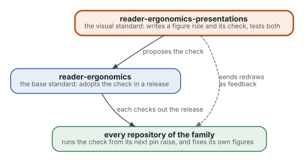

# Shape: figure

A figure or a diagram in any document of the family has this shape. Its parts: a caption that states the message, a drawing rendered from a source kept beside it, a text alternative, and a long description for a complex figure.

## When to use it

- Wherever a page explains a relation, a set, a process or a quantity, which [draw relations](https://github.com/Tewf/reader-ergonomics/blob/v1.7.0/principles/page/draw-relations.md) asks to show drawn.
- In a page read on GitHub or on a site. A file read in a terminal or by a model (AGENTS.md, llms.txt, a comment in code, a commit message) keeps a typed figure ([drawn from source](../principles/figure/drawn-from-source.md)).
- For a diagram of relations, Graphviz ([decision 0007](../decisions/0007-diagrams-are-drawn-with-graphviz.md)). Inside a LaTeX document, TikZ.

## Parts

| Part | What it does | Rule | Grade |
|---|---|---|---|
| Caption | states the figure's one message as a sentence | [one message](../principles/figure/one-message.md) | supported with caveat |
| Drawing | the SVG, rendered from the source and embedded in the page | [drawn from source](../principles/figure/drawn-from-source.md) | convention, untested |
| Alt text | says the message in one sentence, for a reader without sight | [text alternative](../principles/figure/text-alternative.md) | convention (a standard) |
| Long description | lists the parts and how they relate, under the figure, when it has more than a few nodes | [text alternative](../principles/figure/text-alternative.md) | convention (a standard) |
| Source | the `.dot` file, beside the SVG and the page that embeds it, named after that page (`standard-how-to-use.dot`); a model and a later editor read it | [drawn from source](../principles/figure/drawn-from-source.md) | convention, untested |
| Key | only when the notation is not obvious; labels sit on what they name | [label in place](../principles/figure/label-in-place.md) | supported with caveat |

The drawing itself follows the rest of the group: [visible lines](../principles/figure/visible-lines.md), [few crossings](../principles/figure/few-crossings.md), [group by region](../principles/figure/group-by-region.md), [position for quantities](../principles/figure/position-for-quantities.md) and [appeal after clarity](../principles/figure/appeal-after-clarity.md).

## Colours

Each kind of thing gets one colour, the same in every figure of a document. Each kind is also named in its box, so colour is never the only cue. The family's figures use three kinds:

| Kind | Fill | Line | Line on white |
|---|---|---|---|
| the repository the page belongs to | `#FBEDE4` | `#B4541A`, heavier | 4.97:1 |
| the base standard | `#E8EEF8` | `#2F5DA8` | 6.46:1 |
| another repository | `#E6F2EA` | `#2E7D4F` | 5.05:1 |
| a link that is depended on | none | `#3D434B` | 9.99:1 |
| a link that may be used | none | `#6A6D77`, dashed | 5.16:1 |

Text is `#1F2328`, and a second line in a box is `#55575F`, both above 4.5:1 on every fill. The font is Inter.

## Three things to check by eye

- An arrow drawn to a frame (a Graphviz cluster) can render as a stub with its label adrift: draw it between two nodes.
- A note that applies to several nodes is joined to each of them, not to one.
- The alt text reads each arrow in the direction the figure defines it: if `u -> v` means "v uses u", say so.

## Render

Write the `.dot`, then render it; the script stamps the SVG with the hash of its source, and `figure-source` checks the stamp:

```sh
python3 checks/render_figure.py path/to/figure.dot
```

## Worked example

The source is [example-figure.dot](example-figure.dot); each part of the shape is filled below.

A figure rule written here reaches every repository through the base standard, and the redraws reach them as feedback.



- reader-ergonomics-presentations writes a figure rule and its check, and proposes the check to reader-ergonomics.
- reader-ergonomics adopts the check in a release; every repository runs it from its next pin raise and fixes its own figures.
- A dashed link goes straight from this repository to every repository: the redraws it offers as feedback.

## What the checks verify

| Check | Verifies |
|---|---|
| `typed-figure` | no figure is typed in characters outside the files listed as exempt |
| `figure-alt` | no image's alt text is its file name or a word for its kind; reader-ergonomics' `figure-captions` fails an empty one |
| `figure-source` | each SVG drawn from a `.dot` holds the hash of that source |
| `figure-contrast` | each line has 3:1 against the page and its own fill, and no colour has an alpha channel |
| `figure-judgment` | asks, per figure, about crossings, labels, grouping, the message and decoration |
