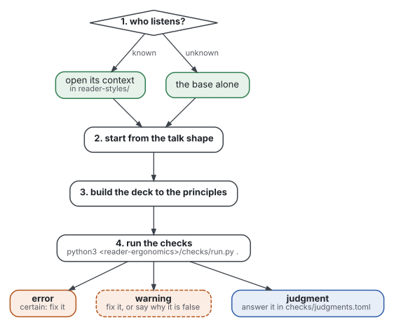
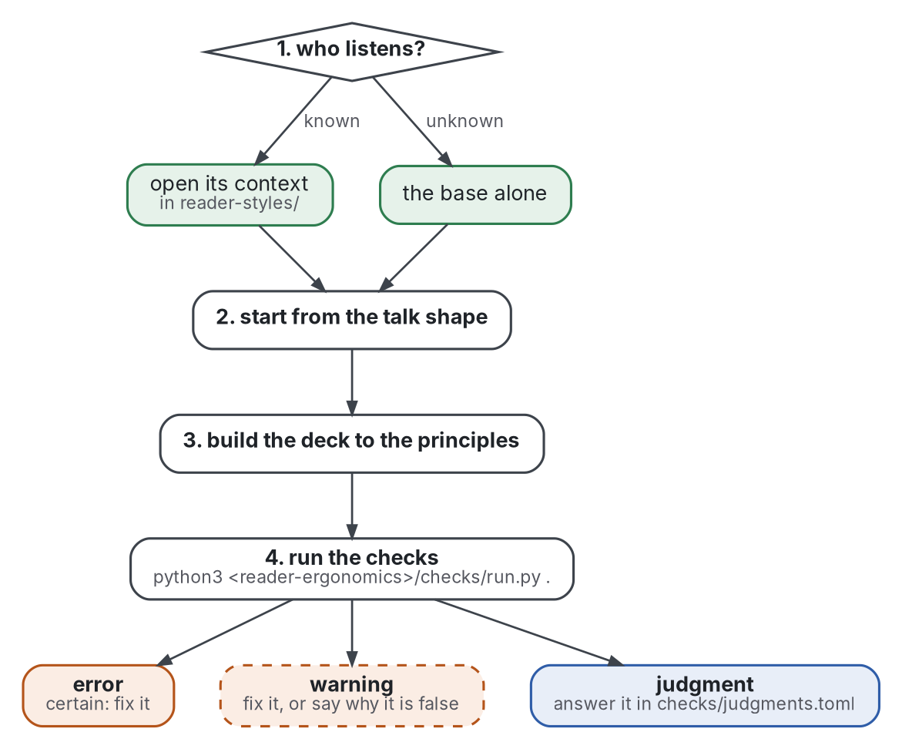

# The presentations standard

What any presentation shares, as far as the evidence goes: the rules for a talk given to a room, with slides or
without. It extends [reader-ergonomics](https://github.com/Tewf/reader-ergonomics/blob/v1.12.0/standard.md), the
standard for any reader: read that one first. This page adds only what a talk changes, since a listener cannot set
the pace or read again.

## How to use it

Graphviz source

1. **Name the audience.** A context overrides the base for its room: [academic audience](reader-styles/academic-audience.md)
   (a conference, a seminar, a defence), [business decision maker](reader-styles/business-decision-maker.md) or
   [casual audience](reader-styles/casual-audience.md) (a meetup, a club, friends).
2. **Start from the [talk shape](shapes/talk.md)**, or from its example deck, [example-talk.html](shapes/example-talk.html).
3. **Build to the principles** below, and to those of reader-ergonomics, which still hold.
4. **Check:** the deck checks of `checks/local/` run with the standard's own, on every HTML deck named in
   `checks/config.toml`.

Grades mean what they mean in [reader-ergonomics](https://github.com/Tewf/reader-ergonomics/blob/v1.12.0/standard.md#grades):
measured, supported with caveat, convention, not supported. Each principle states its grade and never claims more.

## Principles

<!-- principles:start -->

### Pace: the listener cannot reread

| Principle | Claim | Grade |
|---|---|---|
| [Motion adds, never replaces](principles/pace/motion-adds-never-replaces.md) | animation, video and live demos are added to an explanation, never in place of it. | supported with caveat |
| [No script on screen](principles/pace/no-script-on-screen.md) | words on screen do not repeat the voice: show key terms and the evidence, and say the rest. | measured |
| [Reveal with the voice](principles/pace/reveal-with-the-voice.md) | points appear as they are spoken, not a whole slide at once. | supported with caveat (recorded narration only) |

### Slide: what the room sees

| Principle | Claim | Grade |
|---|---|---|
| [Claim headline with evidence](principles/slide/claim-headline-with-evidence.md) | each slide's headline is a sentence stating its claim, and the slide shows the evidence. | supported with caveat (one controlled study of a bundle) |
| [Colour as a signal](principles/slide/colour-as-a-signal.md) | colour links what belongs together and is never the only cue; data colour maps are perceptually ordered. | measured for colour coding and for colour maps |
| [Legible in the room](principles/slide/legible-in-the-room.md) | text is readable from the back of the room: dark on light, high contrast, large type. | measured for polarity; the minimum size is a convention |

### Talk: the speaker and the hour

| Principle | Claim | Grade |
|---|---|---|
| [A talk is not a paper](principles/talk/a-talk-is-not-a-paper.md) | a talk is its own genre: it says its point and plan early, returns to them, and ends on the point. | supported with caveat (descriptive genre research) |
| [Gesture with the words](principles/talk/gesture-with-the-words.md) | the speaker gestures at what is said; a visible face adds nothing consistent. | measured |
| [Plan the questions](principles/talk/plan-the-questions.md) | the questions are part of the talk: the likely ones are prepared, with backup slides. | convention (the research is descriptive) |

### Figure: how a figure is drawn

| Principle | Claim | Grade |
|---|---|---|
| [Appeal after clarity](principles/figure/appeal-after-clarity.md) | decoration stays only when it carries the message and alters no quantity; polish comes after the other figure rules hold, and never replaces them. | supported with caveat (the meta-analyses are measured, for interfaces) |
| [Drawn from source](principles/figure/drawn-from-source.md) | a page read on GitHub or on a site draws its figures from source files, a Graphviz `.dot` kept beside each SVG, and does not type them as text art. Text figures stay only in files read in a terminal or by a model. | convention, untested. The reasons are access and drift, not faster reading |
| [Few crossings](principles/figure/few-crossings.md) | in a node-link diagram, links cross as little as possible, and crossings that remain meet near a right angle. | supported with caveat (small samples; one study against) |
| [Group by region](principles/figure/group-by-region.md) | what belongs together is shown by a bounded region or a joining line, with colour as a second cue and never the only one. | supported with caveat (laboratory evidence) |
| [Label in place](principles/figure/label-in-place.md) | each node and link is labelled where it sits; a legend is used only when direct labels do not fit. | supported with caveat; for direct labels, mainly convention |
| [One message](principles/figure/one-message.md) | a figure has one message, and its title or caption states it. | supported with caveat |
| [Position for quantities](principles/figure/position-for-quantities.md) | a figure that shows a quantity shows it by position on a common scale, or by length, before angle or area. | measured, for charts |
| [Text alternative](principles/figure/text-alternative.md) | every figure has a short text alternative that says what it shows, and a complex figure also has a long description; a filename or a caption alone does not count. | convention (a standard), untested with readers of documentation |
| [Visible lines](principles/figure/visible-lines.md) | lines, arrows, borders and fills that carry meaning have at least 3:1 contrast against what lies next to them. | convention (a standard) |

<!-- principles:end -->

## Where the evidence is

Every principle links to the review in [evidence/presentations/](evidence/presentations/), and every work cited is
listed once in the [bibliography](evidence/bibliography.md).
